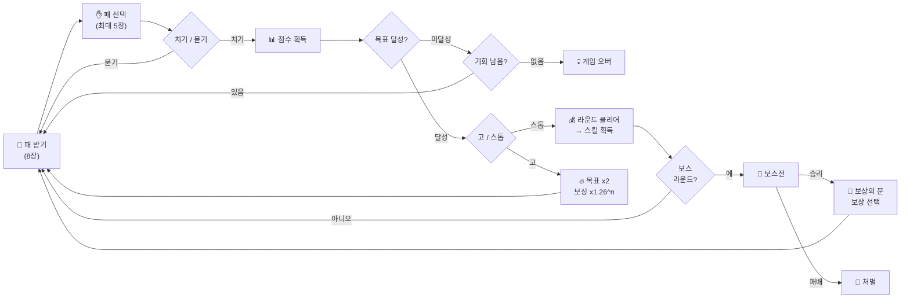

# 🎴 Blosharper 게임 가이드

Blosharper는 한국의 **화투**와 로그라이크 덱빌딩 게임 **발라트로(Balatro)**에서 영감을 받아 만들어진 게임입니다.

> **🌱 처음이신가요?** 화투를 모르셔도 괜찮습니다 — [처음 오신 분께 (How to Play)](./HOW_TO_PLAY.md)가 카드 읽는 법부터 첫 판을 끝내는 데까지 데려다줍니다. 이 문서는 그다음에 펼치셔도 늦지 않습니다.

> **💡 빠른 참고**: [카드 스킬 가이드](./SKILLS_GUIDE.md) | [UI/UX 가이드](./UI_UX_GUIDE.md) | [보스전 가이드](./BOSS_BATTLE.md)

---

## ⚡ 빠른 시작 (Quick Start)

**5분 안에 알아야 할 핵심 규칙:**

1.  **8장**의 패를 받고, **족보**를 만들어 점수를 냅니다.
2.  라운드마다 **치기 5회**, **묻기(버리기) 3회** 기회가 있습니다.
3.  라운드 **목표 점수** 달성 → 돈으로 전환 → **100억 빚 상환**이 최종 목표.
4.  목표 달성 시 **"고(Go)"**(2배 목표에 도전)하거나 **"스톱(Stop)"**(안전하게 수익 확보)을 선택합니다.
5.  라운드 클리어 시 **카드 스킬**을 얻어 점수를 강화합니다.
6.  매 **4라운드**마다 **보스전**이 등장합니다. 보스를 이기면 **보상의 문**이 열려, 받을 보상을 직접 고릅니다.
7.  **상점(마스터 숍)**에서 HP 회복, 스킬 구매, 빚 상환 등을 할 수 있습니다.
8.  **게임 오버**: 목표 미달성 시 파산, 고(Go) 실패 시 나가리, 체력(HP) 0 시 사망.

> [!TIP]
> 처음이라면 **"스톱"**으로 안전하게 자금을 모으고, 상점에서 스킬을 강화하는 것이 생존의 핵심입니다!

### 🔄 게임 루프



---

## 📋 목차

- [⚡ 빠른 시작](#⚡-빠른-시작-quick-start)
- [📖 게임 스토리](#📖-게임-스토리-그림자-도시-키프리스)
- [🎮 게임 방법](#🎮-게임-방법)
- [🎴 화투패 구성](#🎴-화투패-구성)
- [✨ 마법패](#✨-마법패-magic-cards)
- [💎 조합패](#💎-조합패-multiple-combinations)
- [🚀 곱연산 4대장](#🚀-곱연산-multipliers-4대장)
- [🎁 카드 스킬 및 손기술 시스템](#🎁-카드-스킬-및-손기술-시스템)
- [🩸 체력 및 마스터 숍](#🩸-체력hp-및-마스터-숍-master-shop)
- [🏦 검은 은행](#🏦-검은-은행-black-bank-이용-가이드)
- [👹 보스전](#👹-보스전-boss-battles)
- [📈 성장 시스템](#📈-성장-시스템-growth--stats)
- [🌱 시드 기능](#🌱-시드-seed-기능)
- [💾 자동 저장](#💾-자동-저장-및-이어하기-save--resume)
- [💡 전략 팁](#💡-전략-팁)
- [🖥️ UI/UX 시스템](#🖥️-uiux-시스템)

## 📖 게임 스토리 (그림자 도시: 키프리스)

비 내리는 밤, 당신은 차가운 빗줄기를 뚫고 **그림자 도시(Shadow City)**의 가장 깊은 곳으로 발을 들입니다. 감감할 수 없는 거대한 빚, 그리고 당신이 직접 서명한 **신체포기각서**.

이곳에서의 도박은 단순히 유희가 아닙니다. 매일 밤 불어나는 지옥 같은 이자를 갚지 못하면 당신의 신체 일부가 하나씩 사라지는 잔혹한 현실입니다. **생존은 빚을 갚기 위한 처절한 수단일 뿐이며, 오직 카드만이 당신이 가진 유일한 무기입니다.**

탐욕과 절망이 지배하는 도시에서 꼼수와 실력을 발휘해 빚을 청산하고, 비로소 '사람'으로서 이 도시를 탈출할 유일한 기회를 쟁취하세요.

- **난이도 상승**: 요구 점수가 **매 라운드 약 1.3배씩 가파르게 상승**하며 당신의 숨통을 조여옵니다. 초반에는 완만하게 느껴지지만, 뒤로 갈수록 감당하기 힘든 점수를 요구하므로 강력한 기술과 덱 강화가 필수적입니다.
- **점수 초기화 (Score Reset)**: 매 라운드가 시작될 때 **현재 점수(칩)는 0점으로 초기화**됩니다. 오직 '상환 완료'된 금액만이 당신의 자유를 앞당깁니다.
- **대출 (Debt) 시스템**:
  - **지옥의 시작**: 게임을 시작함과 동시에 **100억 전**의 빚이 당신의 어깨를 짓누릅니다.
  - **복리 사채 이자 (New Run Interest)**: 새로운 런(New Game) 시작 시마다 남은 빚에 복리 사채 이자가 부과됩니다. 이율은 캐릭터 레벨이 오를수록 등비(기하급수) 곡선으로 증가하며, 만렙(60레벨) 기준 최대 **0.8%**입니다. 남은 빚이 줄어들수록 이율도 함께 감쇄되고, 저레벨 구간에서는 이자가 거의 붙지 않아 성장을 방해하지 않습니다. (단, 데모 빌드에서는 억까 방지를 위해 사채 이자가 발생하지 않습니다.)
  - **강제 상환**: 라운드 목표 점수를 달성하면 획득한 칩이 돈으로 전환되어 빚을 갚는 데 사용되거나 지갑에 보관됩니다.
  - **막다른 길**: 손패를 모두 사용했는데도 라운드 목표를 달성하지 못하면 해결사들이 당신을 찾아올 것입니다. (Game Over)

제한된 횟수의 **손패(핸드)**와 **묻기(버리기)** 기회를 전략적으로 사용하여 살아남으세요.

- 라운드마다 최대 **5회** 손패 플레이
- 라운드마다 최대 **3회** 묻기

## 🎮 게임 방법

1.  **게임 시작**: **0칩**을 가지고 시작하며, **8장**의 패를 받습니다. (무자비한 시작)
    - 패는 항상 **월 순으로 정렬**되어 표시됩니다 (1월부터 12월, 귀는 항상 마지막 13월).
    - 화면 크기에 따라 패 영역이 자동으로 스케일 조정(0.8~1.0배)되어 모든 패가 보이도록 합니다.
2.  **패 선택**: 마우스 클릭으로 족보를 만들 패(최대 5장)를 선택합니다.
    - 선택한 패의 예상 점수가 **실시간 미리보기** 박스에 표시됩니다.
    - 미리보기 박스는 "족보명 | 배점 x 배수" 형식으로 표시됩니다.
    - 보너스 추가 카드 스킬이 있으면 패를 선택하지 않아도 미리보기에 보너스 효과가 표시됩니다.
    - **툴팁 기능**: 배점과 배수에 마우스를 올리면 점수가 어떻게 계산되는지 자세히 볼 수 있습니다.
      - 배점 툴팁: 패 점수, 조합 보너스, 카드 스킬 보너스 분해
      - 배수 툴팁: 기본 배수, 카드 스킬 배수 분해
    - 목표 점수를 달성할 수 있는 조합이면 미리보기 박스가 **빛나는 효과**로 표시됩니다.
3.  **플레이 (Play Hand)**: - `치기` 버튼을 눌러 점수를 획득합니다. - 족보가 성립되면 기본 점수 + 족보 보너스 x 배수가 적용됩니다. - **점수 증가 애니메이션**: 점수가 부드럽게 증가하는 애니메이션으로 표시되며, 증가하는 동안 숫자가 커지는 효과가 나타납니다. - 사용한 패는 사라지고, 본패에서 새 패를 받아 **8장**을 유지합니다. - 라운드마다 최대 **5회**까지 플레이할 수 있습니다.
4.  **묻기 (Discard)**:
    - 필요 없는 패를 선택하고 `묻기` 버튼을 누릅니다.
    - 선택한 패는 버려지고, 새 패를 받아 **8장**을 유지합니다.
    - 라운드마다 최대 **3회**까지 버릴 수 있습니다.
    - **암묵적 고(Implicit Go)**: 만약 목표 점수를 달성한 상태(스톱 버튼이 활성화된 상태)에서 `묻기`를 수행하면, **"고!"를 외친 것과 동일하게 간주**됩니다. 즉시 스톱 버튼이 사라지며 다음 목표를 향해 달려야 합니다.
    - **기본 이자 삭제**: 라운드 클리어 시 제공되던 기본 이자(5%)는 더 이상 지급되지 않습니다.
    - **기술 활용**: "💹 이자 놀이" 기술을 보유하고 있을 때만 이번 판에 벌어 지갑에 남긴 돈에 비례한 이자를 받을 수 있습니다.
    - 라운드 클리어 시 **카드 스킬**을 선택할 수 있습니다.

### 🎴 고 & 스톱 (Go & Stop) 규칙

목표 점수를 달성하면 **"스톱(Stop)"** 또는 **"고(Go)"**를 선택할 수 있는 기회가 주어집니다. (자동 진행)

- **고 (Go)**: 계속 진행하여 점수를 더 쌓기로 결정합니다.
  - **행위 정의**: 고/스톱 선택이 가능한 상태에서 **`묻기(Discard)` 또는 `치기(Play Hand)`를 수행하는 것**을 '고' 선언으로 간주합니다.
  - **목표 점수 증가**: 목표 점수가 **2배** 증가합니다.
  - **보상 증가**: 이번 판에서 딴 점수(Round Score)에 **(1.26 ^ 고 횟수)** 배수가 적용되어 보너스로 지급됩니다.
    - 1고: x1.26배
    - 2고: x1.58배
    - 3고: x2.00배
    - 4고: x2.52배 (대박!)
- **스톱 (Stop)**: 여기까지 딴 돈만 먹고 안전하게 빠집니다. 즉시 라운드가 종료되고 정산 화면으로 넘어갑니다.
- **주의사항 (Strict Nagari Rules)**:
  - 한번 "고"를 외치거나(묻기/치기 포함), 늘어난 새 목표 점수를 달성해야 하는 상황에서 손패를 다 썼는데 목표를 못 채우면? 이전까지 얼마를 벌었든 상관없이 **즉시 게임 오버 (나가리)** 처리됩니다. (**낙장불입!**)

> [!IMPORTANT]
> **🕵️ 타짜의 조언: "고"를 외치기 전 반드시 체크할 것!**
>
> 1.  **남은 기회**: 남은 손패(Hand)와 묻기(Discard) 기회가 다음 목표를 채우기에 충분한가요?
> 2.  **2배의 압박**: 다음 목표는 지금보다 **2배** 높은 점수입니다. 현재 패의 화력으로 감당 가능한지 냉정하게 판단하세요.
> 3.  **낙장불입**: "고"를 선언한 뒤 실패하면 이번 라운드 수익은 물론, **게임 자체가 끝납니다.**
> 4.  **멈춤의 미학**: 무리한 "고"보다는 안정적인 "스톱"으로 자금을 확보하고, 상점에서 덱을 강화하여 다음 라운드를 기약하는 것이 진정한 타짜의 롱런 비결입니다.

5. **게임 오버**: 다음 조건 중 하나라도 만족하면 게임이 종료됩니다.
   - 손패 횟수(5회)를 모두 사용했는데도 목표 점수를 달성하지 못한 경우
   - **나가리 (Nagari)**: "고" 상태에서 늘어난 목표 점수를 달성하지 못한 경우 (이전 달성 기록 무효)
   - 본패와 손패 모두 비어버려서 더 이상 패를 뽑거나 플레이할 수 없고, 목표 점수를 내지 못한 경우

   > [!TIP]
   > **💰 자산 구제 (Asset Rescue)**:
   > 목표 점수를 채우지 못해 파산할 위기에서, 당신의 지갑에 충분한 돈이 있다면 확률적으로 기적이 일어납니다.
   - **발동 조건**: 신체 사망이 아니고(HP > 0), 지갑에 상응하는 돈(목표 점수 이상)을 보유했을 때 발생합니다.
   - **확률**: 기본 **30%**의 확률이며, 당신의 **요행(Luck)** 수치가 높을수록 기적은 더 자주 찾아옵니다.
   - **선택권**: 구제 기회가 찾아오면 **[계속 버틴다] / [포기한다]** 선택 모달이 나타납니다. 포기하면 그대로 게임 오버로 진행됩니다.
   - **대가**: 계속을 선택하면 지갑의 돈 절반(50%)을 몰수당하지만, 목숨을 부지한 채 **현재 판을 계속 이어서** 할 수 있습니다. (벼랑 끝에서의 생존)
   - **주의**: 자산 구제는 돈만 뺏어갈 뿐, **줄어든 체력(HP)을 회복시켜 주지는 않습니다.**

   > [!TIP]
   > **💸 자동 빚 상환 (Soft Game Over)**:
   > 만약 파산으로 게임 오버가 되었을 때, **체력(HP)**이 남아있다면 마지막 자비가 발동합니다.
   >
   > - 지갑(Money)에 남은 돈으로 **빚(Debt)을 자동으로 상환**합니다.
   > - 비록 게임은 끝났지만, 남은 돈으로 빚을 털어내어 다음 생(?)을 위한 마음의 짐을 덜 수 있습니다.

**본패 소진 처리**: 라운드 중에는 본패가 비어버려도 묻은 패나 사용한 패를 재활용하지 않습니다. 본패가 비어버리면 더 이상 패를 뽑을 수 없으며, 이는 전략적 제약이 됩니다. 새 라운드가 시작될 때만 모든 패가 본패로 복구됩니다.

---

## 🩸 체력(HP) 및 마스터 숍 (Master Shop)

Blosharper의 사기 도박판은 목숨을 걸어야 합니다. 단순히 돈을 잃는 것뿐만 아니라, **신체적 위협**이 항상 존재하며, 이를 관리하기 위해 **마스터 숍**을 방문해야 합니다.

### 🔨 신체 손상 (HP 감소)

- **체력 바**: 화면 좌하단 플레이어 대시보드 근처에 표시됩니다.
- **감소 조건**: 손기술을 쓰다 뽀찌꾼에게 걸렸을 때 발생합니다.
  - **뽀찌를 주면**: **5%**의 낮은 확률로만 발생합니다. (비교적 안전)
  - **배째라 하면**: **40%**의 높은 확률로 **오함마**가 날아옵니다!
  - **방어**: **요행(Luck)** 스탯이 높으면 맞을 확률이 0%까지 줄어들고, **눈치(Insight)** 스탯이 높으면 맞아도 덜 아픕니다.
- **빈사 상태**: 체력이 낮아지면 화면이 붉게 변하며 체력 바가 경고의 의미로 깜빡입니다.
- **자연 회복**: 라운드가 끝날 때, 마지막 회복 시점으로부터 **매 10분마다 HP가 1씩 회복**됩니다. (물리적인 시간 기준)

### 🏥 마스터 숍 (Master Shop)

라운드 진행 중 언제든지 대시보드의 **[뒷골목]** 버튼(단축키 M)을 눌러 뒷골목으로 이동해 **마스터 숍**에 입장할 수 있습니다. 이곳은 매혹적인 **홍마담(💃)**이 운영하며, 기술 전수 시에는 은밀하게 **마스터(🕵️)**가 나타납니다. (정식으로 소개받기 전에는 '낯선 노인'으로만 표시됩니다.)

#### 🏷️ 메뉴 및 아이템

| 아이콘 | 이름                     | 효과                                       | 기본 가격 |
| :----: | :----------------------- | :----------------------------------------- | :-------- |
|   💊   | **알약**                 | 피로 회복, **HP +10**                      | 300전     |
|   🩹   | **반창고**               | 상처 치료, **HP +30**                      | 1,000전   |
|   💋   | **약차**                 | 모든 체력을 완벽하게 회복 **(HP 100%)**    | 5,000전   |
|   🛡️   | **생명 보험**            | 사망(체력 0) 시 1회 부활 (레벨/스탯 보존)  | 20,000전  |
|   🧠   | **뇌세척**               | **모든 스탯 초기화** 및 투자한 포인트 환급 | 5,000전   |
|   📜   | **기술 전수**            | 무작위 **고급 카드 스킬** 획득             | 25,000전  |
|   👂   | **정보 구매**            | 게임에 도움이 되는 팁이나 뒷소문 청취      | 100전     |
|   💸   | **빚 상환**              | 100억의 굴레에서 벗어나 자유를 쟁취        | 변동      |

#### 🛡️ 생명 보험 (Life Insurance) 상세 가이드

가장 강력하지만 해금하기 까다로운 아이템입니다. 진정한 타짜만이 가입할 수 있는 자격이 주어집니다.

- **해금 조건**: 뒷골목에서 **정보 구매**로 특정 소문을 들은 상태에서, **빚(Debt)이 0원**인 채 **라운드 5 이상**에 도달해야 합니다. (연속 생존 카운트는 없습니다 — 조건을 갖춘 순간 해금됩니다.)
- **주요 효과**:
  - 체력이 0이 되어 **'죽음 (YOU DIED)'** 위기에 처했을 때 **죽음을 면하고 소프트 게임오버(Soft Game Over) 상태로 전환**됩니다.
  - 부활 시 다음 생을 위해 **최대 체력의 30%**를 회복합니다.
  - 로그라이크 규칙(초기화)을 깨고 **현재의 단(Level), 짬(XP), 스탯**을 모두 보존합니다.
  - **주의**: 보험은 죽음만 막아줄 뿐, **현재 진행 중인 판(라운드)을 계속하게 해주지는 않습니다.** 보험 발동 시 해당 세션은 종료되며 타이틀 화면으로 돌아갑니다.
- **주의 사항**:
  - **1회용 소모품**입니다. 부활 시 보험 효력이 사라지므로 다시 가입해야 합니다.
  - 아예 처음부터 다시 시작할 경우 해금 상태가 초기화되어 해금 조건을 다시 만족해야 합니다.

#### 💸 물가 변동 시스템 (Dynamic Pricing)

마스터 숍의 가격은 고정되어 있지 않습니다. 당신의 성장과 상황에 따라 시시각각 변합니다.

1.  **레벨 비례 물가 상승**: 플레이어의 **단(Level)**이 높아질수록 상점의 모든 물가도 기하급수적으로 폭등합니다. (고소득자에게 더 많은 돈을 뜯어냅니다!)
2.  **빚쟁이 할증**: **빚(Debt)**이 남아있다면 패널티로 가격이 **20% 할증**됩니다.
3.  **단골 할인 (눈치)**: **눈치(Insight)** 스탯이 높다면 홍마담과의 협상을 통해 가격을 최대 **60%까지 할인**받을 수 있습니다.

> **💡 팁**: 돈을 많이 벌었다고 방심하지 마세요. 나중엔 알약 한 알도 수십만 원이 될 수 있습니다!

> **⚠️ 물가 상승 안내**: 플레이어의 **단(Level)**이 높아질수록 상점의 모든 물가도 기하급수적으로 폭등합니다. 돈을 많이 벌었다고 방심하지 마세요!

### 🎴 화투통 (Deck Types)

게임을 진행하다 보면 서로 다른 **화투통 4종**을 골라 장착할 수 있게 됩니다. 화투통은 시작 덱의 성격을 정하는 장비이며, 마스터 숍의 **화투통 개조**에서 바꿉니다.

- **⚪ 기본 화투통**: 개조하지 않은 순수한 화투통. 특화 버프 없이 오직 실력으로 승부합니다.
- **✨ 광·조커 전략통**: 광·조커 득점이 강화되고, 후반 라운드일수록 광·조커 족보의 최종 배수가 치솟습니다.
- **🍃 열끗·띠 전략통**: 홍단·청단·고도리 등 띠·열끗으로 득점할수록 후반 라운드의 최종 배수가 치솟습니다.
- **🌙 월·땡 전략통**: 같은 월을 모으는 땡·연월 계열이 강해지고, 후반 라운드일수록 최종 배수가 치솟습니다.

각 전략통은 특화의 대가로 다른 계열의 득점이 소폭 감쇄됩니다. 자신의 빌드 방향에 맞는 통을 고르세요.

#### 💰 개조 삯은 예약금입니다

화투통 개조는 **예약**입니다. 삯을 먼저 치르고, 바뀐 통은 **다음 판부터** 손에 들어옵니다.

- **지급 시점**: 개조를 **확정하는 순간** 삯이 빠져나갑니다. 다음 판이 시작되어 통이 실제로 바뀔 때 **또 청구하지는 않습니다.**
- **되돌리기**: 마음이 바뀌어 **지금 쓰는 통을 다시 고르면** 예약이 취소되고 **삯을 전액 돌려받습니다.**
- **바꿔 예약**: 예약해 둔 통을 **다른 통으로 바꾸는 것은 공짜입니다.** 이미 맡겨 둔 예약금이 그대로 넘어갑니다.
- **오르는 삯**: 개조를 거듭할수록 삯이 올라갑니다. 그 값과 지갑 잔고는 개조 화면의 **개조 삯** 칸에 그때그때 표시됩니다.
- **통장에서 끌어오기**: 지갑이 모자라면 통장에서 끌어와 치를 수 있습니다. 다만 그때 붙는 **인출 수수료는 예약을 물려도 돌아오지 않습니다.**

> **💡 팁**: 삯이 아까워 망설일 필요는 없습니다. 예약을 물리면 그대로 돌려받으니, 통을 골라 두고 판을 시작하기 전에 다시 생각해도 늦지 않습니다.

### 💀 죽음 (Death)

- **전치 0주**: 체력이 0이 되는 순간, 당신은 타짜로서의 생명은 물론 **물리적인 죽음**을 맞이합니다.
- **전환**: 더 이상 현재의 판을 이어갈 수 없으며, **YOU DIED** 메시지와 함께 **영구적인 게임 오버**로 처리됩니다.
- **생명 보험 미가입 시**: 모든 **단(Level)**, **짬(XP)**, **스탯**, **카드 스킬**이 완전히 소멸됩니다. (처음부터 다시 시작)

### 🔄 새 출발 (Start Anew)

- **리셋**: 죽음을 맞이했을 때 보험이 없다면 모든 정보가 소멸됩니다.
- **재시작**: 인트로 시퀀스를 통해 새로운 타짜의 삶을 부여받게 됩니다.
- **전략**: 홍마담의 약차로 항상 체력을 챙기고, 만약의 사태를 대비해 보험에 가입하는 것이 롱런의 비결입니다!

---

## 🏦 검은 은행 (Black Bank) 이용 가이드

초기 빚 100억을 모두 갚고 자유를 얻게 되면 당신만의 비밀 계좌, **'검은 은행'**이 해금됩니다. 계좌가 열릴 때는 그동안 모아둔 잔금을 정리한 **'최초 정착금'**이 입금된 상태로 시작합니다. 이곳은 단순히 돈을 보관하는 곳이 아니라, 당신의 자산을 지키는 전략적 요충지입니다.

### 💰 지갑 vs 은행 잔고

- **지갑 (Money)**: 즉시 꺼내 쓸 수 있는 현금입니다. 상점 구매·약방 이용·빚 상환·은행 입금에 사용되며, 라운드 수익도 지갑으로 들어옵니다. (라운드에 들어갈 때 지갑에서 빠져나가는 참가비는 없습니다 — 잔고가 0이어도 판은 계속됩니다.)
- **은행 잔고 (Bank Balance)**: 은밀하게 보관된 자산입니다. **캐릭터가 사망하더라도 은행 잔고는 몰수되지 않고 그대로 유지**됩니다. 잔고를 불리려면 직접 입금해야 합니다 — 라운드 수익이 저절로 예치되지는 않습니다.

### 💸 수수료표 (은행은 공짜로 일하지 않는다)

| 항목                    | 요율          | 비고                                                                                  |
| :---------------------- | :------------ | :------------------------------------------------------------------------------------ |
| **출금 수수료**         | 기본 **10%**  | 직접 방문 시 **눈치(Insight)** 스탯에 따라 최대 80% 감면 (최종 **2%**)                 |
| **입금세 (기본분)**     | 기본 **30%**  | 직접 방문 시 눈치 스탯에 따라 최대 **6%**까지 감면                                     |
| **입금세 (누진분)**     | 최대 **+40%** | 이번 런에서 자산을 불린 **성장률**에 비례해 가산. **할인 불가**, 합산 상한 **70%**     |
| **보관료**              | 잔고의 **10%** | 새 런을 시작할 때마다 예금 잔고에서 차감                                              |
| **마이너스 통장 이자**  | 복리          | 잔고가 마이너스라면 새 런 시작 시마다 복리 이자가 붙어 더 깊어집니다                   |

- **부족분 자동 인출**: 결제 시 지갑이 모자라면 은행 잔고에서 수수료를 포함해 자동 인출됩니다.
- **자동 대피 (Rescue)**: 게임 오버가 되면 지갑에 남은 돈이 입금세를 떼고 은행으로 자동 대피합니다. 다음 생을 도모할 수 있는 소중한 밑천이 될 것입니다.
- **방문의 미학 (성실 보너스)**: 직접 마스터 숍을 찾아가 입/출금을 요청하면 **눈치(Insight)** 스탯만큼 수수료가 크게 감면됩니다. 번거로움을 무릅쓰고 발로 뛰는 타짜만이 누릴 수 있는 성실함의 대가입니다.

> [!TIP]
> 입금세 누진분은 "이번 런에서 자산을 얼마나 불렸는가"에 반응합니다. 자산을 배로 불린 런일수록 세율이 무거워지니, 예치 타이밍도 전략입니다.

### 📒 통장 내역 (Passbook)

은행 잔고에 일어나는 **모든 변동**(입금, 출금, 보관료, 이자, 자동 대피 등)은 통장에 빠짐없이 기록됩니다. 은행 창구에서 **통장 내역**을 요청하면 최근 거래를 조회할 수 있으니, "돈이 왜 줄었지?" 싶을 때는 통장부터 펴 보세요.

---

## 👹 보스전 (Boss Battles)

매 4라운드마다 강력한 **보스**가 등장하여 특별한 규칙으로 플레이어를 괴롭힙니다.

- **빈도**: 4, 8, 12... 라운드마다 등장 (4의 배수)
  - **일반 보스 (4대천왕)**: 4, 8, 16, 20... 라운드 (12의 배수 제외)
  - **최종 보스 (칼치)**: 12, 24, 36... 라운드 (12의 배수)
- **위협**: 타임 어택, 카드 금지, 세금 징수 등 다양한 페널티 부여
- **처벌 (The Beating)**: 보스전 패배 시 **체력(HP)에 직접적인 타격**을 입습니다. (자산으로 막을 수 없습니다)
  - **생존 시 (추방)**: 목숨은 건졌으나 골목에서 쫓겨납니다. 라운드 및 자금은 초기화되지만, **그동안 쌓은 성장(레벨/스탯)은 고스란히 유지**됩니다. (로그라이크)
  - **사망 시 (죽음)**: 체력이 다하면 모든 것을 잃는 진정한 게임 오버입니다.

**👉 자세한 내용은 [보스전 가이드](./BOSS_BATTLE.md)를 참고하세요.**

### 🏆 보스 클리어 리워드 (Deck Building Rewards)

보스전에서 승리하면 **보상의 문**이 열립니다. 세 문이 나란히 서고, 그중 **고른 문의 보상만** 받습니다.

|      문       | 받는 것                                                                       |
| :-----------: | :---------------------------------------------------------------------------- |
| 🃏 **기사 위탁** | 화투통을 손보는 **위탁 기술 하나**를 받습니다. 받은 자리에서 바로 손봅니다 — 피 추가·피 제거·패 끼워넣기·패 빼돌리기는 **두 장**, 그 밖의 위탁은 **한 장**입니다 |
| ✨ **고귀한 봉투** | 봉투 셋 중 하나를 골라 **마법패**를 얻습니다 (종전의 봉투 흐름 그대로)          |
| 🤏 **손기술**  | 그 보스의 **손기술**을 익히거나 한 단계 끌어올립니다                            |

- **몇 개나 고르나 — 이번 판의 「고」가 정합니다.** 기본은 **1개**이고, 보스를 잡은 판에서 **고를 3회 이상** 외쳤으면 **2개**, **7회 이상**이면 **3개**를 고를 수 있습니다. 문 위에 「이번 판 고 n회 → 문 m개」가 그대로 적혀 있습니다.
- **고르기는 토글입니다.** 문을 누르면 선택되고, 다시 누르면 풀립니다. 잘못 눌러도 되돌릴 수 있으니 급하게 정하지 마세요. **[확인]을 눌러야** 보상이 집행됩니다.
- **고를 수 있는 만큼 다 골라야** [확인]이 열립니다. 보상을 남기고 넘어가는 길은 없습니다.
- **못 고르는 문은 사라지지 않고 잠긴 채로 섭니다.** 그 자리에 이유가 적힙니다 — 그 보스의 손기술을 이미 끝까지 익혔거나, 지금 맡길 수 있는 위탁이 하나도 없을 때입니다.
- **정해진 돈 보상은 문과 무관합니다.** 보스를 이기면 라운드에 비례한 돈이 따로 들어오고, 문은 그 위에 얹히는 선택입니다.

> **⚠️ 주의**: 문은 **고른 것만** 줍니다. 예전처럼 봉투가 저절로 열리지 않으니, 마법패를 원한다면 **고귀한 봉투** 문을 직접 고르세요.

**👉 자세한 내용은 [마법패](#✨-마법패-magic-cards) 섹션과 [보스전 가이드](./BOSS_BATTLE.md)를 참고하세요.**

---

## 🎴 화투패 구성

게임에는 총 **50장**의 화투패가 사용됩니다. (48장 + 귀 2장)
각 패는 다음과 같은 타입으로 분류됩니다:

| 아이콘 |       타입        | 설명                              | 기본 점수 |
| :----: | :---------------: | :-------------------------------- | :-------: |
|   🌟   |  **광 (Gwang)**   | 가장 강력한 패 (비광 포함)        |   월 점   |
|   🦜   | **열끗 (Animal)** | 동물이나 사물이 그려진 패         |   월 점   |
|   🎀   |  **띠 (Ribbon)**  | 띠가 그려진 패 (홍단, 청단, 초단) |   월 점   |
|   🩸   |   **피 (Junk)**   | 일반 패                           |   월 점   |
|  🩸🩸  | **쌍피 (Double)** | 피 2장분의 가치                   |   월 점   |
|   👹   |  **귀 (Joker)**   | 만능패 (월 대체 가능)             |   13점    |

**패 기본 점수 규칙**:

- **귀를 제외한 모든 패**는 월 번호와 동일한 기본 점수를 가집니다.
  - 예: 1월 광 = 1점, 3월 광 = 3점, 11월 광 = 11점
  - 예: 1월 피 = 1점, 12월 피 = 12점
  - 예: 11월 쌍피 = 11점, 12월 쌍피 = 12점
- **귀**는 항상 13점의 고정 점수를 가집니다.

---

## ✨ 마법패 (Magic Cards)

보스전 승리 보상으로 획득할 수 있는 강력한 속성 카드입니다. 일반 카드와 달리 독특한 아우라와 함께 카드 위에 **등급 휘장(Badge)**이 표시됩니다.

### 🎖️ 마법 속성 등급

마법 속성은 카드의 '기민 점수'를 폭발적으로 증가시킵니다.

|    등급    | 이름 |  효과   | 매커니즘         |
| :--------: | :--: | :-----: | :--------------- |
|  **GOLD**  |  금  | **x10** | `기본 점수 x 10` |
| **SILVER** |  은  | **x5**  | `기본 점수 x 5`  |
| **BRONZE** |  동  | **x3**  | `기본 점수 x 3`  |

### 🧬 속성 중첩 (Stacking)

한 카드에 여러 속성이 중첩될 수 있습니다. 이때 배율은 **합산**되어 적용됩니다.

- **예시**: `금(x10)` + `동(x3)` 속성을 가진 1월 카드의 점수
  - `1점(기본) x (10 + 3) = 13점` (**Magic Base Score**)

> [!TIP]
> 마법카드는 족보 점수의 '재료'가 되는 베이스 칩 자체를 키워주기 때문에, 후반부 배수 뻥튀기 효율을 결정짓는 핵심 요소입니다. ❤️

---

보통 **최대 5장**의 패를 선택하여 제출해 족보를 만듭니다. 게임을 진행하다 보면 **특정 카드 조합으로만 발동하는 숨겨진 룰**을 만나 전세를 역전시킬 수도 있습니다.

### 💰 점수 계산 방식 (하이브리드 모델)

Blosharper는 족보의 가치와 개별 카드의 성장을 동시에 반영하기 위해 **합연산 후 곱연산** 방식을 사용합니다.

```javascript
최종 점수 = floor(( sum(카드별 마법 점수) + 족보 보너스 + 스탯 보너스 + 스킬 보너스 ) × 최종 배수)
```

1. **베이스 칩 (Base Chips)**: 제출된 카드들의 `Magic Base Score`를 모두 합산합니다.
2. **보너스 (Bonus)**: 족보 자체 보너스, 스탯(구라), 카드 스킬 보너스를 모두 더합니다.
3. **최종 배수 (Final Multiplier)**: 기본 플레이어 배수(1.0)에 카드 스킬의 배수를 더하고, 족보 고유 배수와 특수 배수(쌍피, 흔들기 등)를 **곱하여** 산출합니다.
   - 즉, 마법카드로 베이스 칩을 키울수록 최종 배수의 위력이 기하급수적으로 증폭됩니다!

**조합패(Multiple Combinations) 시스템** 💎: 같은 패로 여러 족보가 동시에 성립하면 **모든 보너스를 합산**하고 **모든 족보 배수를 곱연산(×)**으로 적용합니다! 도파민 분출을 위해 족보끼리는 서로의 위력을 증폭시킵니다.

- **조합 보너스**: 조합1 보너스 + 조합2 보너스 + ... (합연산)
- **족보 배수**: 조합1 배수 × 조합2 배수 × ... (곱연산)
- **특수 배수**: 쌍피(×2) × 귀(+배수) × 흔들기(×2) 등 (곱연산)
- 예시: 비삼광(+60, ×3) + 연월(+40, ×2)
  - 칩/보너스: (칩 + 60 + 40)
  - 족보 배수: 3 × 2 = **6.0** (곱연산)
  - 쌍피 있으면: 6.0 × 2 = **12배!** (곱연산)

**상위/하위 조합 필터링**: 같은 종류의 조합은 상위 조합만 적용됩니다.

- 광: 오광 > 사광 > 삼광/비삼광
- 띠: 비초단 > 오단/홍단/청단/초단 (메가 콤보 예외 적용)
- 동물: 고도리 + 열끗 모두 인정 (메가 콤보)
- 월: 귀통/땡폭탄 > 총통 > 폭탄 > 쌍땡 > 땡

**🩸 쌍피 배수 규칙 (Ssangpi Multiplier) - 엔드게임의 핵심!** 🚀

> **"쌍피를 지배하는 자가 고득점을 지배한다."**
> 귀(Joker)가 함정 카드라면, 쌍피는 이 게임의 진정한 **치트키**입니다. 이걸 모르고는 절대 엔드게임을 볼 수 없습니다!

- **발동 대상 (월패·연월 계열)**: 쌍피 배수는 **땡, 쌍땡, 폭탄, 땡폭탄, 총통, 귀통, 연월** 족보에서 발동합니다. 스킬이고 나발이고 필요 없습니다 — 해당 족보에 **쌍피 속성 카드**가 기여하고 있으면 무조건 발동!
  - 11월: **똥쌍피** + 11월 패 (같은 월 아무거나)
  - 12월: **비쌍피** + 12월 패 (같은 월 아무거나)
  - 9월: **국진(열끗/쌍피)** — 단, 월패/연월 족보에 기여할 때만
- **효과 (Multiplicative x2)**: 족보에 기여한 쌍피 **장당 x2**를 최종 배수에 곱해줍니다!
  - 이 **x2**는 족보 배수 위에 곱해지므로 효과가 기하급수적입니다.
  - 예시: 4배짜리(귀통) 족보에 쌍피가 2장 포함되면?
    - **계산**: 1.0(기본) × 4(족보) × 2(쌍피1) × 2(쌍피2) = **16배!** 💥
    - 만약 배수 스킬이 있다면 효율은 더욱 미쳐 날뜁니다.
- **개발자 팁**: 족보 외우기 귀찮으면 그냥 **"쌍피 들고 같은 월 짝맞추기"(땡 계열)**나 **연월**을 노리세요. 족보 배수가 높을수록 효율이 폭발합니다.

- **열끗/고도리 조합**: 동물 카드로만 인정되며, **쌍피 배수는 적용되지 않습니다** ❌
- **월패/연월 조합**: 쌍피 조건을 만족하여 **쌍피 배수(×2)가 적용됩니다** ✅
- 예시 1 (열끗): 동물 5장 → 고도리(+80, ×5) + 열끗(+70, ×4) = ×20 (쌍피 배수 없음)
- 예시 2 (월패): 똥쌍피(11) + 11월광 → 땡(+10, ×2) + **쌍피(×2)** = ×4

- **고도리 + 열끗**: 고도리(2월, 4월, 8월)를 포함하여 동물 5장을 내면 둘 다 인정
  - 보너스: 고도리(+80) + 열끗(+70) = **+150**
  - 배수: 고도리(×5) × 열끗(×4) = **×20** (합연산이 아닌 곱연산으로 도파민 폭발!)
- **오단 + 초단 (또는 홍단/청단)**: 오단(5장)에 초단/홍단/청단이 포함되면 모두 인정
  - 예: 1~5월 띠 → 오단(+70, ×3) + 홍단(+80, ×4) = **+150, ×12** (배수도 곱연산!)

예시:

- 연월(x2) + 쌍피 발동(x2) = **x4** 배수 적용
- 땡폭탄(x3) + 쌍피 발동(x2) = **x6** 배수 적용
- 쌍땡(x2) + 쌍피 발동(x2) = **x4** 배수 적용

---

### 🌟 광 조합 (Gwang Sets)

| 족보명        | 구성                   | 보너스 | 배수 |
| :------------ | :--------------------- | :----: | :--: |
| 👑 **오광**   | 광 5장                 |  +100  | x15  |
| ☀️ **사광**   | 광 4장                 |  +80   |  x4  |
| ⭐️ **삼광**   | 비광(12월) 제외 광 3장 |  +70   |  x3  |
| 🌧️ **비삼광** | 비광(12월) 포함 광 3장 |  +60   |  x3  |

### 🎀 단 조합 (Ribbon Sets)

| 족보명        | 구성                              | 보너스 | 배수 |
| :------------ | :-------------------------------- | :----: | :--: |
| 🎗️ **오단**   | 띠 5장                            |  +70   |  x3  |
| 🔴 **홍단**   | 1, 2, 3월 홍단 띠 3장             |  +80   |  x4  |
| 🔵 **청단**   | 6, 9, 10월 청단 띠 3장            |  +80   |  x4  |
| 🌿 **초단**   | 4, 5, 7월 초단 띠 3장             |  +60   |  x3  |
| 🌦️ **비초단** | 초단 3장 + 12월 비띠 1장 (총 4장) |  +90   |  x5  |

### 🦜 끗 조합

| 족보명        | 구성                                   | 보너스 | 배수 |
| :------------ | :------------------------------------- | :----: | :--: |
| 🦅 **고도리** | 2월(매조), 4월(흑싸리), 8월(공산) 열끗 |  +80   |  x5  |
| 🦁 **열끗**   | 동물 카드 5장                          |  +70   |  x4  |

### 📅 월 조합 (Same Month Sets)

| 족보명        | 구성                                | 보너스 | 배수 |
| :------------ | :---------------------------------- | :----: | :--: |
| 👺 **귀통**   | 같은 월 5장                         |  +80   |  x4  |
| 💥 **총통**   | 같은 월 4장                         |  +50   |  x3  |
| 🔗 **연월**   | 연속된 5개 월 (예: 1-5월, 2-6월...) |  +40   |  x2  |
| 🏠 **땡폭탄** | 같은 월 3장 + 다른 월 2장           |  +40   |  x3  |
| 💣 **폭탄**   | 같은 월 3장                         |  +30   |  x2  |
| 🍒 **쌍땡**   | 같은 월 2장씩 2벌                   |  +20   |  x2  |
| 🔔 **땡**     | 같은 월 2장                         |  +10   |  x2  |

### 📜 마법 조합 (Magic Set)

| 족보명               | 구성                   | 보너스 | 배수 |
| :------------------- | :--------------------- | :----: | :--: |
| 🔮 **마법사의 비급** | **마법 속성** 카드 5장 | +100   |  x3  |

보스전 보상으로 모은 **마법패만 5장**을 내면 성립하는 전용 족보입니다. 마법패의 뻥튀기된 기본 점수와 시너지가 뛰어납니다.

---

### 🃏 숨겨진 카드 룰 (Hidden Rules)

정확히 **2장**의 패만 내면 발동하는 특수 조합들이 판 곳곳에 숨어 있습니다. 점수 대신 **판의 흐름을 바꾸는 강력한 유틸리티 효과(룰 체인저)**에 특화되어 있으며, 발동 시 제출한 카드의 개별 점수·등급 보너스 등 바닥 점수는 **0점**으로 처리됩니다. 어떤 조합이 어떤 효과를 내는지는 직접 판 위에서 발견하는 것이 이 게임의 재미 — 여기서는 두 가지만 살짝 공개합니다.

- **🪵 구사**: 4월과 9월의 열끗/띠 조합 (열끗 2장 제외). 손패가 마음에 들지 않을 때 **덱을 다시 섞고 손패를 새로 받습니다.** 턴을 소모하지 않는 무료 리셋!
- **🐎 암행어사**: 특정 2장 조합으로 발동하며, **일반 보스의 스킬을 카운터**하는 비장의 무기입니다. 카운터 효과는 해당 라운드 동안 지속되며, 보스의 위협적인 패턴을 즉시 중단시킵니다. 조합 레시피는 직접 찾아보세요.

> [!IMPORTANT]
> **성립 조건**: 숨겨진 카드 룰은 **반드시 딱 2장의 패만 선택하여 제출**했을 때만 발동합니다. 3장 이상의 패를 내면 일반 족보나 끗으로 처리됩니다.

> [!NOTE]
> 숨겨진 조합들은 기본적으로 0점으로 계산되지만, **전용 시너지 스킬**을 장착하면 고득점과 높은 배수를 획득하는 강력한 원천이 되기도 합니다.

### 🎴 기본 점수 (족보 없을 때)

| 족보명     | 설명                                                                                                           |              점수               |
| :--------- | :------------------------------------------------------------------------------------------------------------- | :-----------------------------: |
| **끗** | 족보가 성립하지 않을 때, 가장 높은 점수 패 하나만 계산 (포커 방식)<br>단, 카드 스킬 보너스는 끗에도 적용됨 | 패 기본 점수 + 카드 스킬 보너스 |

**연월 카드 스킬 효과**: "단연월" 카드 스킬이 있으면 연월이 **4장만** 있어도 인정됩니다.

- 예: 1월, 2월, 3월, 4월 → 연월 인정
- 귀와 조합 가능: 1월, 2월, 귀, 4월 → 연월 인정

---

## 💎 조합패 (Multiple Combinations)

같은 패로 여러 족보가 동시에 성립하면 **모든 보너스와 배수가 적용**됩니다!

### ✨ 조합패 점수 계산

```
최종 점수 = (칩 + 보너스1 + 보너스2 + ...) × (베이스 1.0 + 스킬들) × (배수1 × 배수2 × ...)
```

**예시: 비삼광 + 연월 (환상의 조합 💎)**

```
패: 8월 광, 9월 피, 10월 피, 11월 광, 12월 비광
(8, 9, 10, 11, 12 연월 & 8, 11, 12 비삼광)

- 카드 점수: 8+9+10+11+12 = 50
- 비삼광: 보너스 +60, 배수 x3
- 연월: 보너스 +40, 배수 x2

계산:
- 베이스 칩: 50 + 60 + 40 = 150
- 총 배수: 3 × 2 = 6.0
- 최종 점수: 150 × 6.0 = 900점!
```

### 🔥 대표적인 조합패

#### 자주 발생 (3장 + 2장)

- **홍단/청단/초단 + 땡**: 띠 3장 + 다른 월 2장
- **고도리 + 땡**: 동물 3장 + 다른 월 2장

#### 희귀 (5장 겹침)

- **고도리 + 열끗** (동물 5장): 3,540점 (177 x 20)
- **청단 + 연월** (6~10월 띠 포함): 1,280점 (160 x 8)

| 순위  | 조합명            |   점수    |   배수    | 구성 패 예시                               |
| :---: | :---------------- | :-------: | :-------: | :----------------------------------------- |
| **1** | **고도리 + 열끗** | **3,540** | **x20.0** | 2,4,8월 동물 포함 동물 5장 (예: 2,4,6,7,8) |
| **2** | **청단 + 연월**   | **1,280** | **x8.0**  | 6~10월 띠 (4×2)                            |
| **3** | **홍단 + 연월**   | **1,080** | **x8.0**  | 1~5월 띠 (1,2,3 포함) (4×2)                |
| **4** | **비삼광 + 연월** |  **900**  | **x6.0**  | 8~12월 (비광 포함 광 3개) (3×2)            |
| **5** | **초단 + 연월**   |  **780**  | **x6.0**  | 4~8월 (4,5,7 포함) (3×2)                   |

> [!TIP]
> **귀(백귀/홍귀)**가 포함될 경우 위 점수는 더욱 폭발합니다! 홍귀의 +2.0은 족보 배수에 더해지는 것이 아니라 **별도의 배수 트랙**(기본 1.0)에 더해지고, 두 트랙은 마지막에 서로 **곱해집니다**. 예를 들어 고도리+열끗(x20.0)에 홍귀가 더해지면 최종 배수는 (1+2.0)×20 = **x60.0**이 됩니다.

### 💡 조합패 UI 표시

족보의 조합이 성립하면:

- 족보명에 **"💎 멀티플! 💎"** 표시
- 조합명이 합쳐져서 표시 (예: "비삼광 + 연월")
- 툴팁에 각 조합의 보너스/배수 상세 정보

---

## 🚀 곱연산 (Multipliers) 4대장

Blosharper의 배수는 대부분 **합연산(Additive, +)**으로 적용되지만, 다음 4가지는 **곱연산(Multiplicative, x)**으로 적용되어 점수를 기하급수적으로 폭발시킵니다. 고득점을 노린다면 이 4대장을 반드시 기억하세요!

### 1. 🔔 흔들기 (Shaking)

- **효과**: 같은 월 3장으로 흔들고 이기면 최종 배수 **x2**
- **조건**: 시작 손패에 같은 월 3장 이상 (귀 제외)
- **전략**: 초반에 뜨면 무조건 승부!

### 2. 🩸 작전 세력 (Syndicate)

- **효과**: 보유한 카드 스킬 개수당 **기본 배수 +0.43 ~ +2.15 추가** (스킬 레벨에 비례)
- **조건**: 영웅급 스킬 '작전 세력' 보유
- **전략**: 만렙 기준 12개 꽉 채우면 **기본 배수에 약 +25.8 추가!** 여기에 족보 배수(x15 등)가 곱해지면... 상상에 맡깁니다.

### 3. 💪 배짱 (Guts)

- **효과**: 초반 레벨이 가파른 곡선으로 최종 배수 증폭 (최대 x3.0)
- **조건**: 스탯 '배짱' 투자
- **전략**: 판이 커질수록 효율 극대화. 엔드게임의 핵심!
  - Lv 15: 약 x1.88
  - Lv 30: x2.5
  - Lv 60: x3.0 (최종 배수 3배!)

### 4. 🩸 쌍피 배수 (Ssangpi)

- **효과**: 대상 족보(땡 계열·연월)에 기여한 쌍피 **장당 최종 배수 ×2** (2장이면 ×4)
- **조건**: 스킬 불필요 — 게임 기본 룰!
- **전략**: 위의 '쌍피 배수 규칙' 참고. 족보 배수가 높을수록 효율이 폭발합니다.

---

### 👹 귀 (만능패)

**귀**는 특별한 패로, 다음과 같은 특징이 있습니다:

- **기본 점수**: **13점** (끗일 때 높은 점수를 보장)
- **만능패 기능**: 어떤 월로든 대체 가능
- **자동 최적화**: 귀가 포함된 패를 선택하면, 자동으로 가장 높은 점수를 내는 조합을 찾아줍니다
- **귀통 조합**: 같은 월 4장 + 귀 1장 또는 같은 월 3장 + 귀 2장으로 **귀통** 조합이 성립됩니다
- **연월 조합 지원**: 귀가 연월 조합에서 빈 값을 채워주는 기능 (예: 1, 2, 귀, 4, 5 → 귀가 3월을 대체하여 연월 완성)

#### 🎴 귀 특수 능력

각 귀는 고유한 특수 능력을 가지고 있습니다:

|     귀      | 능력      | 효과                                                                   |
| :---------: | :-------- | :--------------------------------------------------------------------- |
| **백귀** 💎 | 보너스 x2 | 조합 보너스 점수를 2배로 증가<br>(예: 홍단 80점 → 160점)               |
| **홍귀** ✨ | 배수 +2   | 배수 트랙(기본 1.0)에 +2 추가<br>(예: 홍단 x4 → (1+2)×4 = **x12**)     |

**능력 적용 순서**: 베이스 칩 계산 → 조합 보너스 계산 → **귀 능력 적용** (백귀: 보너스 x2, 홍귀: 배수 트랙 +2) → **족보 배수를 곱연산**(쌍피 배수 포함) → 최종 점수

> [!IMPORTANT]
> 배수는 **두 갈래**로 굴러갑니다. 족보 배수(고도리 x5, 홍단 x4 …)와 쌍피 배수는 한쪽 트랙에서 서로 곱해지고, 홍귀의 +2는 **반대쪽 트랙**(기본 1.0)에 더해집니다. 최종 점수는 마지막에 두 트랙을 곱해서 냅니다. 그래서 홍귀는 족보가 클수록 더 크게 벌어집니다 — 배수를 그냥 더하는 것으로 읽으면 위력을 크게 낮춰 보게 됩니다.

#### 🎨 귀 이미지

- **기본 귀** (본패에 포함된 백귀/홍귀): 고유한 백귀/홍귀 이미지 사용
- **카드 스킬 귀** ("👹 위탁: 귀 추가" 카드 스킬로 추가된 귀): 5가지 랜덤 이미지 중 하나 사용
  - 카드 스킬로 추가된 귀도 백귀/홍귀 능력을 랜덤으로 가지며, 시각적으로 다양한 귀 이미지로 표현됩니다
  - 인벤토리(I 키)에서 위탁: 귀 추가 스킬에 마우스를 올리면 추가된 모든 귀의 타입과 개수를 확인할 수 있습니다

**예시:**

- 1월 3장 + 귀 2장 = **귀통** (1월 5장으로 인식)
- 2월 2장 + 3월 2장 + 귀 1장 = 귀가 2월 또는 3월로 대체되어 **폭탄** 또는 **쌍땡** 성립
- 홍단(1,2,3월 띠) + 백귀 = 조합 보너스 80점 → **160점**으로 증가
- 홍단(1,2,3월 띠) + 홍귀 = 배수 x4 → (1+2)×4 = **x12**로 증가
- 홍단 + 백귀 + 홍귀 = 보너스 160점, 배수 x12로 **강력한 시너지**

---

### 🔔 흔들기 (Shaking)

라운드 시작 시, **같은 월의 패가 3장 이상** 들어오면 **흔들기**가 발동합니다.

- **조건**: 시작 손패에 같은 월 패가 3장 이상 있을 때 (귀 제외)
- **효과**: 이번 라운드의 최종 점수가 **2배**가 됩니다! (최종 배수에 x2 곱연산)
- **주의**: 카드를 묻거나, 흔든 카드를 치지 않으면 흔들기 발동이 취소됩니다.
- **연출**: 해당 패들이 흔들리는 애니메이션과 함께 "흔들기!" 메시지가 나타납니다.

---

## 🎁 카드 스킬 및 손기술 시스템

라운드를 클리어하거나 라운드 진행 중 대시보드의 버튼을 통해 **마스터 숍(Master Shop)**을 방문하여 **카드 스킬**을 전수받을 수 있습니다. 이곳은 평소엔 **홍마담(💃)**이 관리하지만, 기술 전수 시에는 은밀하게 **마스터(🕵️)**가 나타납니다.

### 핵심 요약

- **스킬 종류**: 점수 증가, 배수 증가, 특수 효과 등 다양한 종류
- **전수 방식**: 상점에 입장하여 원하는 카드 스킬을 선택하고 복채를 지불합니다.
- **연속 전수**: 상점에 한 번 입장하면 복채가 허용하는 한 **여러 스킬을 계속 전수**받을 수 있습니다.
- **파워업 시스템**: 같은 스킬을 여러 번 전수받으면 레벨업!
- **스마트 인벤토리**:
  - 기본 6개 슬롯 제공 (확장 가능)
  - 인벤토리가 가득 차면 **자동으로 패널이 열려** 즉시 스킬을 교체할 수 있습니다.
  - 은신처에서 불필요한 스킬을 바로 반납하고 새 스킬을 전수받을 수 있습니다.
- **물리기 (Reroll)**: 라운드 클리어 보상으로 제시된 스킬 후보가 마음에 들지 않으면 돈을 내고 다시 뽑을 수 있습니다. 기본가는 **다음 라운드 목표 점수의 약 3%**이며, 물릴수록 가격이 점점 오릅니다. **눈치(Insight)** 스탯으로 최대 60%까지 할인됩니다.
- **2단계 해금 보류 시스템 (Pending Unlock)**:
  - 인게임 플레이 중 특정 스킬의 해금 조건(최고 점수, 턴 생존 등)을 충족하더라도 **즉시 상점에 등장하지 않고 '해금 보류(Pending)' 상태**가 됩니다.
  - 이는 게임 진행 도중 빌드의 방향성이나 밸런스가 갑자기 흔들리는 것을 방지하기 위함입니다.
  - 보류된 스킬들은 해당 판이 끝난 **게임오버 최종 정산 화면**에서 일괄적으로 보여지며, 컬렉션에 영구 등록(`commit`)된 후 **다음 판부터 상점에 등장**합니다.

### 🃏 손기술 (Hand Techniques)

카드 스킬과 별개로, 판 자체를 직접 조작하는 **손기술 7종**이 존재합니다. 손기술은 **이번 런 한정**이며(런이 끝나면 소멸), 같은 기술을 다시 얻으면 **최대 Lv.3**까지 강해집니다.

| 손기술          | 효과                                                             |
| :-------------- | :--------------------------------------------------------------- |
| 💥 **탄**       | 선택한 패를 더미의 패와 바꿔치기                                 |
| 🂠 **밑장빼기** | 더미의 가장 아래 패를 몰래 빼서 사용                             |
| 🎯 **낱장치기** | 손패 1장을 남은 덱의 패와 몰래 바꿔치기 (저격)                   |
| 👁️ **표시목**   | 다음에 올 패를 미리 훔쳐보기                                     |
| ⏪ **무르기**   | 마지막 치기를 되돌리기 (그 치기로 번 점수도 함께 되돌아감)       |
| ✂️ **기리치기** | 라운드 시작 시 떼어낸 패 후보 중 원하는 패를 1~3장 선택하여 시작 |
| 🪄 **스데끼**   | 정해진 횟수만큼 같은 월패가 확정으로 뽑히도록 더미를 조작        |

- **획득**: 5종은 **보스전 승리 전리품**입니다 — 보상의 문에서 **손기술** 문을 고르면 그 보스의 기술이 **확정으로** 들어옵니다. 같은 보스를 다시 이기고 또 그 문을 고르면 기술이 레벨업합니다. 기본기 2종(기리치기·스데끼)은 한 번에 **큰 점수**를 냈을 때 확률적으로 몸에 붙습니다.
- **쓰는 대가 — 의심**: 손기술은 쓰는 즉시 효과를 내지만, 그때마다 뽀찌꾼의 **의심 게이지**가 오릅니다. 오르는 양은 기술마다 달라서 무르기와 기리치기가 가장 크고, 탄·낱장치기·밑장빼기가 그다음, 표시목이 가장 작습니다. 저절로 걸리는 **스데끼**만은 의심을 사지 않습니다.
- **숙련**: 같은 기술의 레벨이 오를수록 의심이 덜 쌓입니다 — **Lv.2는 40%**, **MAX(Lv.3)는 80%** 덜 오릅니다.
- **봉인**: 게이지가 가득 찼을 때 범인으로 손기술이 지목되면, 그 손기술은 **봉인**되어 쓸 수 없게 됩니다. 라운드가 바뀌어도 풀리지 않으며, 약방에서 완전히 치료받을 때 운이 따르면 함께 풀립니다.
- **🎯 낱장치기 상세**: 원하는 **목표 카드 1장**을 정해두고 노리는 '품질형 저격'입니다. 레벨이 오를수록 적중 정확도가 높아지고(Lv.1 추첨 가중 ×4 → Lv.2 ×8 → MAX 확정 저격), **적중 확률은 사용 전에 그대로 공개**됩니다. 버프는 획득 라운드를 포함해 **3라운드** 동안 유지되며, 덱이 소진되면 사용할 수 없습니다.

- **패널티 (단속 시스템) - 의심 게이지 시스템**:
  - **의심 게이지**: 손기술을 쓰거나 카드 스킬을 지닌 채 패를 칠 때마다 뽀찌꾼의 **의심 게이지**가 누적됩니다. 게이지가 임계값(100)에 도달하면 발각!
    - **Heat(상승)**: 손기술(스데끼 제외) 사용, 카드 스킬을 지닌 채 치기(치기마다 조금씩), 대박 점수(판돈 10배 이상)로 게이지가 올라감
    - **Cooldown(감소)**: 묻기(-6), 판돈 미달(-3), 라운드 클리어(-10)로 게이지가 내려감
    - **경고 단계**: 게이지 50 / 70 / 90 도달 시 뽀찌꾼이 경고 대사를 읊음 (보스전에서는 보스가 대신 경고)
  - **유예된 발각**: 손기술을 쓰다 걸려도 즉시 게임이 멈추지 않습니다. 대신 **점수를 정산할 때** 뽀찌꾼(밀고자)이 나타납니다.
  - **뽀찌(Bribe) 요구**: 뽀찌꾼은 당신이 이번 판에서 번 **점수(수익)의 40%~150%**를 뽀찌로 요구합니다. (수익을 통째로 넘겨야 할 수도 있습니다!)
  - **선택의 순간**:
    - **💸 뽀찌 주기**: 수익을 나눠주고 **스킬을 지킵니다.** (안전함)
    - **🙅 배째라 / 몸으로 때우기**: 거절하면 **이번 판 수익은 보존**되지만, 스킬은 압수당하며 오함마 이벤트가 발생합니다. 운이 좋다면... (안 아플 수도?)
    - **🎲 결백 증명 (주사위 승부)**: 뽀찌를 낼 돈이 모자랄 때는 주사위로 결백을 주장할 수 있습니다. **주사위 3개(3D6) + 요행 보정(요행의 절반)**의 합이 목표치(기본 10) 이상이면 성공 — 성공 시 이번 판 정산이 **2배**가 됩니다! 단, 이번 런에서 우긴 횟수만큼 목표치가 +2씩 올라가고, 주사위가 모두 1이면 무조건 실패합니다. 발뺌에 실패하면 괘씸죄로 **오함마 피해 1.5배**를 맞고 의심 게이지도 크게 재점화됩니다.
  - **능력치 영향**:
    - **눈치(Insight)**: 뽀찌 비율을 깎아줍니다.
    - **요행(Luck)**: 게이지 상승량 자체를 줄여줍니다.

- **머니 시스템**:
  - **전수 비용**: 스킬의 등급과 강화 수준에 따라 크게 달라집니다. 마스터의 무작위 기술 전수(복채)는 기본 25,000전에서 시작해 물가에 따라 변동합니다.
  - **반납**: 현재 상점가의 50% + 보유 라운드당 +10% 숙성 보너스 (특정 스킬 보유 시 숙성 속도 2배)
  - **수익**: 라운드 클리어 시 칩이 돈으로 전환되어 지갑에 적립
  - **기본 이자 삭제**: 기본 이자 시스템은 삭제되었습니다. "💹 이자 놀이" 스킬이 있어야 이자를 받을 수 있습니다.
  - **빚 (Debt)**: 초기 100억 전의 빚을 갚는 것이 최종 목표입니다. ⚠️ **판돈**은 빚이 아니라 **그 라운드에 넘어야 할 목표 점수**를 가리키는 이름입니다(누적 점수는 **딴돈**). 헷갈리지 마세요.

**📚 자세한 내용**: [카드 스킬 가이드 →](./SKILLS_GUIDE.md)

### 🔮 스킬 각성 (Skill Awakening)

진정한 타짜는 기술을 극한까지 연마하여 새로운 경지에 도달합니다.

- **조건**: 특정 **기술 2개를 보유** (만렙 불필요, 보유만 하면 조합 가능)
- **효과**: 두 기술을 융합하여 **신화(Mythic)** 또는 **고유(Unique)** 등급의 각성 기술 1개를 획득합니다.
- **방법**:
  1. 인벤토리(I) 우측 하단의 **[🔮 기술 각성]** 버튼에 'N' 표시가 뜨면 클릭합니다.
  2. 조합 레시피와 성공 확률을 확인합니다. 성공 확률은 **기본 20%에 요행 스탯 보정(레벨당 +0.1%p)**이 붙고, 여기에 **재료 스킬의 레벨 비율(현재 레벨 ÷ 만렙)**이 곱해집니다. (평상시 상한 30%)
  3. 비용을 지불하고 조합을 시도합니다.
     - **성공**: 재료 스킬 2개가 사라지고, 강력한 각성 스킬 1개가 인벤토리에 들어옵니다.
     - **실패**: **재료 스킬은 사라지지 않고 그대로 남습니다** — 지불한 수업료(비용)만 날아갑니다. 대신 실패할 때마다 성공 확률이 +1%p씩 쌓이고(최대 +10%p, 최종 상한 40%), 성공하면 그 레시피의 보정이 초기화됩니다.
- **특징**:
  - 각성 기술은 **상점에서 등장하지 않으며**, 오직 조합으로만 만들 수 있습니다.
  - 재료로 사용된 기술의 빈자리가 생기므로, 새로운 기술을 전수받을 수 있는 슬롯이 확보됩니다 (인벤토리 압축).

---

## 🖥️ UI/UX 시스템

Blosharper는 직관적이고 세련된 UI/UX를 제공합니다.

### 핵심 기능

- **실시간 점수 미리보기**: 선택한 패의 예상 점수를 실시간으로 표시
- **콤비네이션 글로우**: 족보 완성 시 패들이 반짝이는 시각적 피드백
- **스마트 툴팁**: 점수/배수 계산 과정을 단계별로 보여주는 툴팁
- **부드러운 애니메이션**: 패 이동, 점수 증가 등 모든 동작에 애니메이션
- **반응형 디자인**: 화면 크기에 따라 자동으로 스케일 조정
- **키보드 단축키**: H(족보 이력), R(족보표), I(인벤토리), D(남은 패 확인), M(마스터숍), T(스탯 관리), U 또는 Ctrl+Z(되돌리기), F7(스톱), F8(힌트), F9/Alt(월 표시), ESC(게임 메뉴)

**🎨 자세한 내용**: [UI/UX 가이드 →](./UI_UX_GUIDE.md)

---

## 💡 전략 팁

- **초반**: 무리한 "고"보다 안정적인 "스톱"으로 자금을 모으고, 상점에서 스킬부터 강화하세요. **구라** 스탯은 기본 점수가 낮은 초반에 효율이 압도적입니다.
- **중반**: 족보 2개 이상을 섞어 내는 **조합패**로 경험치 배수를 유지하고, 곱연산 4대장(흔들기·작전 세력·배짱·쌍피)을 중심으로 빌드를 짜세요.
- **후반**: **마법패**로 베이스 칩을 키울수록 배수의 위력이 기하급수적으로 커집니다. 쌍피 짝과 고배수 족보를 함께 노리세요.

---

## 📈 성장 시스템 (Growth & Stats)

게임 플레이를 통해 얻은 짬(경험치)로 단을 올리고, 스탯을 찍어 나만의 빌드를 만들 수 있습니다.

### 🌱 기본 성장 규칙

- **최대 단 (Max Level)**: 단수 60
- **짬(XP) 획득 원칙**: **"돈을 버는 순간 짬도 쌓인다!"**
  1.  **족보 제출**: 획득한 점수의 규모에 비례하여 짬(XP)을 얻습니다. 점수가 커질수록 상승폭이 서서히 완만해지는 방식을 사용하여, 대박을 터뜨렸을 때도 균형 잡힌 성장이 가능합니다.
  2.  **패널티 없음**: 발각되거나 벌금을 내도 획득한 짬은 사라지지 않습니다.
- **영구 저장 (Roguelike)**: 게임을 끄거나 재시작해도 단과 스탯은 유지됩니다!

### 🆙 라운드 콤보 (Round Combo - XP Bonus)

**"족보를 섞어 내면 경험치가 폭발한다!"**

매 핸드마다 **2개 이상의 족보(조합패)**를 동시에 달성하면, 획득하는 경험치(XP) 배수가 즉시 2배로 증가합니다. 이 배수는 콤보가 유지되는 동안 계속 누적됩니다!

- **발동 조건**: 한 번의 패 제출(Hand)에서 **족보가 2개 이상** 성립될 때 (예: 홍단 + 폭탄)
- **효과**: 현재 XP 배수가 **2배**로 뻥튀기되고, **이번 판의 XP부터 즉시 적용**됩니다.
  - 1단계: 2배
  - 2단계: 4배
  - 3단계: 8배
  - 4단계: **16배 (MAX)**
- **초기화 조건**:
  - 족보를 1개만 내거나, 족보가 없을 때 (Multiplier Reset 1x)
- **배수 유예**: 2장으로 발동하는 **특수 카드 룰**(구사 등)을 낸 턴에는 배수가 리셋되지도, 오르지도 않고 **그대로 유지**됩니다.
- **전략**: 광렙을 원한다면 점수가 낮은 족보라도 **계속 섞어서(조합패)** 내는 것이 핵심입니다.
  - 예: "땡 + 띠" (2배) → "땡 + 폭탄" (4배) → "홍단 + 땡" (8배)...

### 💪 4가지 핵심 스탯

단이 오를 때마다 주어지는 **SP(Stat Point)**로 다음 4가지 스탯을 올릴 수 있습니다. (각 스탯 최대 단수 60)

|        스탯        | 아이콘 | 주요 효과                   | 상세 설명                                                                                                                                                                                                                                                                                           |
| :----------------: | :----: | :-------------------------- | :-------------------------------------------------------------------------------------------------------------------------------------------------------------------------------------------------------------------------------------------------------------------------------------------------- |
| **구라 (Deceit)**  |   🤥   | 고정 칩 점수 추가 (**최대 +300**) | **판돈 사기치기 (고정 점수 추가)**<br>• 족보/카드 점수에 관계없이 고정 점수 추가 — 초반 레벨이 가장 가파른 선급형 곡선<br>• **초반/망한 판**에서 압도적인 효율 (10단만 찍어도 +91점!)<br>• 로그에서 \`(기본+보너스+구라)\` 형태로 확인 가능                                                                                                       |
|  **배짱 (Guts)**   |   💪   | 배수 **곡선형 증폭 (최대 x3.0)**   | **판 키우기 (배수 증폭)**<br>• 최종 배수를 증폭 (**최대 3배**) — 초반 레벨이 가파른 선급형 곡선<br>• **후반/대박 판**에서 효율 극대화<br>• 점수가 클수록 효과가 기하급수적                                                                                                                                                           |
| **눈치 (Insight)** |   👁️   | 경제 **할인 및 협상**       | **할인 및 협상 전문가**:<br>• 뽀찌(개평) 요구액 할인 (최대 20%p)<br>• 마스터 숍 물건/기술 구매 비용 할인 (최대 60%p)<br>• 오함마 피해 경감 (최대 50%p)                                                                                                                                              |
|  **요행 (Luck)**   |   🍀   | 확률 **보정 및 회피**       | **행운의 여신 (곡선 보정)**:<br>• **희귀 카드 스킬 발견 확률** 증가 (만렙 최대 +60%)<br>• **의심 게이지 상승 감소** (곡선형, 최대 100% 감소)<br>• **처벌(부상) 회피율** 증가 (최대 40%p)<br>• **손기술(기본기) 획득 확률** 보정 (고득점 시)<br>• 확률형 카드 스킬(판돈 경감 등) 발동 확률 보정 |

#### 📊 스탯별 상승 곡선 (레벨당 효과)

**구라** (고정 합연산, 초반이 가장 가파른 선급형 곡선):

- 10단: +91칩 (기본 점수가 낮을 때 강력)
- 30단: +225칩
- 60단: +300칩 (최대)

**배짱** (곱연산, 선급형 곡선):

- Lv 15: 약 x1.88 (+88%)
- Lv 30: x2.5 (+150%)
- Lv 60: x3.0 (+200%) - 최종 배수 3배 증폭!

**눈치** (경제/방어):

- **구매 할인**: 마스터 숍 물가 상승을 억제하고 할인을 받습니다. (Lv.60 기준 최대 60% 할인)
- **뽀찌(개평) 할인**: 발각 시 뜯기는 뽀찌 비율을 줄여줍니다. (기본 40~150% → 최대 20%p 감소)
- **피해 경감**: 오함마를 맞았을 때 입는 피해(HP)를 줄여줍니다. (최대 50% 경감)

**요행** (확률/회피):

- **행운 발동**: 초반 레벨이 가파른 곡선으로 상승해 만렙(60)에서 최대 **+60%**. 상점에서 **희귀/전설 등급의 카드 스킬**이 등장할 확률을 높여줍니다.
- **손기술 획득**: 큰 점수를 냈을 때 **기본기 손기술이 몸에 붙을 확률**을 높여줍니다. (행운 보너스의 30%만큼 가산)
- **스킬 발동**: 판돈 경감 등 **확률형 카드 스킬**의 발동 확률을 행운 보너스만큼 높여줍니다.
- **의심 게이지 감소**: 손기술 사용 시 의심 게이지 상승량을 획기적으로 낮춰줍니다. (곡선형, Lv.60 도달 시 상승량 0%)
- **처벌 우회**: 발각되거나 오함마를 맞을 위기에서 **최대 40% 확률**로 피해를 0으로 만듭니다. (완전 회피)

---

## 🌱 시드 (Seed) 기능

Blosharper는 **결정론적 무작위성(Deterministic Randomness)**을 지원합니다. 시드 기능을 통해 고유한 난수 값을 입력하면, 언제 어디서든 동일한 덱 구성과 게임 흐름을 재현할 수 있습니다.

### 🧩 시드란 무엇인가요?

- **정의**: 게임 내 무작위 요소를 생성하는 기초가 되는 문자열입니다.
- **특징**: 동일한 시드로 시작하면 **항상 같은 순서로 카드가 덱에서 나옵니다.**
- **독립성**: 카드, 상점, 보스, 보상 등이 서로 독립된 난수를 사용하여, 상점에서 리롤을 하더라도 이후에 나올 보스나 보상이 바뀌지 않습니다. (순수 실력 검증 가능!)
- **형식**: `ABCD-1234`와 같이 8자리의 영문 대문자와 숫자로 구성됩니다. (입력 시 하이픈이나 공백은 자동으로 무시됩니다)

### ⌨️ 사용 방법

1.  **타이틀 화면**의 중앙 하단에 있는 시드 입력 필드를 클릭합니다.
2.  공유받았거나 기록해둔 시드 값을 입력합니다. (예: `LUCKY-SEVEN`)
3.  **[시작하기]** 버튼을 누르면 입력한 시드로 즉시 새 게임이 시작됩니다.

### 🚫 시드 플레이 제한 사항 (Seeded Play Rules)

시드 플레이는 특정 상황을 연습하거나 친구와 실력을 겨루기 위한 용도이므로, 공정성을 위해 다음과 같은 제한이 적용됩니다:

- **성장 불가**: 단(Level)이 오르지 않으며, SP(Stat Point)를 획득하거나 투자할 수 없습니다.
- **기록 미반영**: 최고 점수 기록이 랭킹이나 로컬 데이터에 저장되지 않습니다.
- **스토리 스킵**: 게임의 내러티브나 스토리 컷신이 나타나지 않고 게임에만 집중하게 됩니다.
- **이어하기 불가**: 시드 플레이는 한 번의 세션으로 끝납니다. 도중에 종료하면 해당 진행 상황은 저장되지 않습니다.

> [!TIP]
> **디버깅과 연구**: 특정 보스의 패턴을 연구하거나, 내가 완성했던 "환상의 조합"을 다시 보고 싶을 때 시드 기능을 적극 활용하세요!

---

## 💾 자동 저장 및 이어하기 (Save & Resume)

게임 진행 상황이 **실시간으로 안전하게 자동 저장**됩니다. 언제든지 게임을 끄고 나중에 다시 돌아와도, 하던 판 그대로 이어서 할 수 있습니다!

### ✅ 자동 저장 시점

다음 행동을 할 때마다 즉시 저장됩니다:

- **라운드 (Round) 시작 시**
- **치기 (Play Hand) 후**
- **묻기 (Discard) 후**
- **손기술 사용 후** (탄 등)
- **목표 점수 달성 후 라운드 완료 시**

### 🔄 이어하기 기능

- 게임을 다시 실행하면 **"이어하시겠습니까?"** 팝업이 나타납니다.
- **이어하기**: 점수, 카드, 카드 스킬 및 손기술 등 모든 상태가 완벽하게 복원됩니다
- **주의**: 게임 오버가 되면 저장 데이터는 로그라이크 규칙에 따라 **즉시 삭제**됩니다!

### 🎮 게임 메뉴

게임 플레이 중 **ESC 키** 또는 상단 **라운드 버튼**을 클릭하면 게임 메뉴에 진입합니다. 메뉴에서는 게임 재시작, 설정 변경, 게임 종료(타이틀 화면 복귀) 등을 할 수 있습니다.
