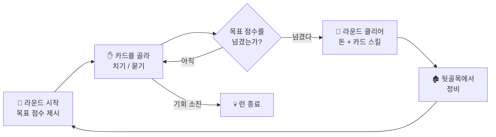

# 🌱 처음 오신 분께 (How to Play)

> **💡 빠른 참고**: [게임 가이드](./GAME_GUIDE.md) | [카드 스킬 가이드](./SKILLS_GUIDE.md) | [보스전 가이드](./BOSS_BATTLE.md) | [단축키 가이드](./KEYBOARD_SHORTCUTS.md)

**화투를 한 번도 본 적 없어도 괜찮습니다.**

이 문서는 화투를 모르는 분을 기준으로 쓰였습니다. 필요한 규칙은 전부 이 안에서 설명하므로, 화투를 따로 배우고 오실 필요가 없습니다. 반대로 전통 화투에 익숙한 분께도 한 가지만 미리 말씀드립니다 — **이 게임의 점수 규칙은 전통 규칙과 다릅니다.** 여기 적힌 것만 알고 계시면 됩니다.

읽는 데 10분, 그러면 첫 판을 굴릴 수 있습니다. 더 깊은 내용은 [게임 가이드](./GAME_GUIDE.md)가 이어받습니다.

---

## 1. 🎴 어떤 게임인가요?

**혼자 하는 카드 조합 퍼즐입니다.** 장르로 부르자면 **로그라이크 덱빌딩** — 카드 뭉치(덱)를 조금씩 강화해 가며 점점 어려워지는 목표에 도전하고, 실패하면 처음부터 다시 시작하는 계열입니다.

- **상대 플레이어가 없습니다.** 맞은편에 앉아 내 패를 받아치는 사람은 없습니다. 당신이 상대하는 것은 화면에 제시된 **목표 점수**와 **남은 기회 횟수**뿐입니다.
- **반사 신경이나 빠른 조작이 필요 없습니다.** 제한 시간도 없습니다. 손에 든 여덟 장을 놓고 어느 조합이 가장 큰 점수를 만드는지 천천히 따져 보는 게임입니다.
- **화투패는 이 퍼즐이 쓰는 재료입니다.** 카드에 그려진 그림과 숫자가 점수 계산의 부품일 뿐, 실제 화투를 재현하는 것이 목적이 아닙니다.

이야기 쪽 배경은 이렇습니다. 주인공은 갚을 수 없는 규모의 빚을 지고 지하 도박장으로 흘러들어온 인물이고, 게임을 시작하는 순간 **100억 전**의 빚이 어깨에 얹힙니다. 카드로 번 돈을 모아 이 빚을 갚아 나가는 것이 여정의 목표입니다.

### 🔁 한 판(런)의 흐름

한 번의 도전을 **런(Run)**이라고 부릅니다. 런은 이렇게 흘러갑니다.



라운드를 넘길 때마다 목표 점수는 가팔라지고, 그 사이사이에 당신은 카드 스킬을 모아 화력을 키웁니다. **점점 세지는 나 vs 점점 높아지는 목표** — 이 줄다리기가 게임의 뼈대입니다.

---

## 2. 🖱️ 화면에서 하는 일은 딱 두 가지

복잡해 보이는 화면이지만, 당신의 손이 하는 조작은 둘뿐입니다.

1. **카드를 클릭해서 고릅니다.** 손에 든 여덟 장 중 **최대 다섯 장**까지 고를 수 있습니다.
2. **`치기` 또는 `묻기` 버튼을 누릅니다.**

| 버튼 | 하는 일 | 단축키 |
| :--- | :--- | :--- |
| **치기** | 고른 카드를 제출해 **점수를 얻습니다.** 낸 카드는 사라지고 새 카드를 받아 다시 여덟 장이 됩니다. | `Enter` |
| **묻기** | 고른 카드를 **버리고** 새 카드를 받습니다. 점수는 얻지 못합니다. | `Delete` / `Backspace` |

> [!TIP]
> 카드를 고르면 화면의 **미리보기 상자**에 "이 조합이면 몇 점"인지 바로 표시됩니다. **점수를 외울 필요가 전혀 없습니다** — 이것저것 골라 보며 숫자가 가장 커지는 조합을 찾으면 됩니다. 조합 목록 전체가 궁금하면 아무 때나 `R` 키를 눌러 족보표를 펼쳐 보세요.

---

## 3. ⏳ 한 라운드가 요구하는 것, 그리고 두 개의 자원

라운드가 시작되면 화면 위에 **목표 점수**가 뜹니다. 그 점수를 넘기면 라운드 통과입니다.

당신에게 주어지는 자원은 두 가지뿐이고, 라운드마다 채워집니다.

| 자원 | 횟수 | 설명 |
| :--- | :---: | :--- |
| 🃏 **치기** | **5회** | 점수를 낼 수 있는 기회. 이 다섯 번 안에 목표를 넘겨야 합니다. |
| 🗑️ **묻기** | **3회** | 쓸모없는 카드를 버리고 다시 뽑는 기회. **점수를 내지 않습니다.** |

- 손에는 **항상 여덟 장**이 유지됩니다. 치기든 묻기든, 쓴 만큼 새로 채워집니다.
- 카드는 **월 순서로 자동 정렬**되어 보이므로 직접 줄 세울 필요가 없습니다.
- **첫 라운드의 목표 점수는 500점**이고, 라운드가 하나 오를 때마다 목표가 **약 1.3배씩** 뜁니다. 처음엔 완만하지만 뒤로 갈수록 무섭게 가팔라집니다.

> [!IMPORTANT]
> **묻기는 점수를 내지 않습니다.** 처음 하시는 분이 가장 자주 하는 실수가 좋은 카드를 실수로 묻어 버리는 것입니다. 버튼을 누르기 전에 어느 버튼인지 한 번 확인하세요.

---

## 4. 🀄 카드 읽는 법 — 화투가 처음이라면

여기만 이해하면 나머지는 술술 풀립니다.

**카드 한 장은 두 가지 정보를 가집니다.**

```
[ 월 번호 1~12 ]  +  [ 그림 종류 ]
```

트럼프 카드에 비유하면 **월 번호가 숫자, 그림 종류가 무늬**에 해당한다고 보시면 거의 맞습니다.

- 덱은 **12개월 × 각 4장 = 48장**으로 이루어져 있고, 여기에 만능패인 **귀 2장**이 더해져 **총 50장**입니다.
- **카드의 기본 점수는 그 카드의 월 번호와 같습니다.** 1월 카드는 1점, 7월 카드는 7점, 12월 카드는 12점. 그림 종류와 무관합니다. (귀만 예외로 항상 13점)

**그림 종류는 다섯 가지입니다.**

| 아이콘 | 종류 | 어떤 카드인가 |
| :---: | :--- | :--- |
| 🌟 | **광** | 가장 귀한 그림. 12개월 중 **1·3·8·11·12월에만** 있어 전부 다섯 장뿐입니다. |
| 🦜 | **열끗** | 동물이나 사물이 그려진 카드. |
| 🎀 | **띠** | 카드에 가느다란 띠가 그려져 있습니다. 띠 색깔(홍·청·초)에 따라 다시 나뉩니다. |
| 🩸 | **피** | 가장 흔한 카드. 덱의 절반 가까이가 이것입니다. |
| 🩸🩸 | **쌍피** | 피 두 장 값을 하는 특별한 피. 딱 세 장 있으며, 나중에 점수를 폭발시키는 열쇠가 됩니다. |
| 👹 | **귀** | 만능패. 필요한 월을 대신해 줍니다. 기본 점수는 13점. |

> [!TIP]
> **지금 외워야 할 것은 "월 번호"와 "그림 종류" 두 가지가 있다는 사실뿐입니다.** 어떤 월에 어떤 그림이 있는지는 외우지 마세요 — 화면의 카드마다 아이콘이 붙어 있고, 조합이 성립하면 미리보기가 알아서 알려 줍니다.

---

## 5. 🧮 카드가 점수가 되는 과정

제출한 카드가 **조합(족보)**을 이루면 점수가 크게 뜁니다. 계산식은 이렇게 생겼습니다.

```
점수 = ( 카드 기본 점수의 합  +  조합 보너스 ) × 배수
```

**조합을 만드는 방법은 크게 세 갈래입니다.**

| 갈래 | 방법 | 예시 조합 |
| :--- | :--- | :--- |
| 📅 **같은 월 모으기** | 월 번호가 같은 카드를 여러 장 | **땡**(같은 월 2장) · **폭탄**(3장) · **총통**(4장) |
| 🎨 **같은 종류 모으기** | 그림 종류가 같은 카드를 여러 장 | **삼광**(광 3장) · **홍단**(홍색 띠 3장) · **열끗**(동물 5장) |
| 🔗 **연속된 월 모으기** | 월 번호가 이어지는 카드 5장 | **연월**(예: 3·4·5·6·7월) |

**처음 노리기 좋은 조합 세 가지**를 뽑으면 이렇습니다.

| 조합 | 만드는 법 | 보너스 | 배수 |
| :--- | :--- | :---: | :---: |
| 🔔 **땡** | 같은 월 2장 | +10 | ×2 |
| 🍒 **쌍땡** | 같은 월 2장씩 두 벌 | +20 | ×2 |
| 💣 **폭탄** | 같은 월 3장 | +30 | ×2 |

### ✏️ 실제로 계산해 보기

첫 판, 스킬도 스탯도 아직 없는 상태에서 이렇게 냈다고 해 봅시다.

> 3월 광 · 3월 띠 · 8월 열끗 · 8월 피 · 12월 피

1. **카드 기본 점수의 합** — 월 번호를 그대로 더합니다. `3 + 3 + 8 + 8 + 12 = 34`
2. **조합 판정** — 3월이 2장, 8월이 2장. 같은 월 2장씩 두 벌이므로 **쌍땡**입니다. → 보너스 **+20**, 배수 **×2**
3. **최종 점수** — `(34 + 20) × 2 = ` **108점**

첫 라운드 목표가 500점이니, 이 정도 판을 다섯 번 치면 540점. **아슬아슬하게 통과**입니다. 그래서 처음엔 묻기를 아끼지 말고 써서 더 나은 조합을 찾는 편이 안전합니다.

### 🎯 알아 두면 좋은 세 가지 규칙

- **조합이 겹치면 배수끼리 곱해집니다.** 낸 다섯 장으로 두 개의 조합이 동시에 성립하면 보너스는 더해지고 **배수는 곱해집니다.** 예를 들어 배수 ×3 조합과 ×2 조합이 함께 잡히면 최종 배수는 **×6**. 고득점은 전부 여기서 나옵니다.
- **조합이 하나도 없으면 "끗" 처리**입니다. 낸 카드 중 **가장 점수가 높은 한 장만** 계산됩니다. 아무 조합도 못 만들었을 때의 최소한의 점수라고 보시면 됩니다.
- **딱 2장만 내면 숨은 규칙이 발동하기도 합니다.** 특정한 두 장의 짝에는 점수 대신 판의 흐름을 바꾸는 효과가 숨어 있습니다. 무엇이 있는지는 직접 발견하는 재미로 남겨 두겠습니다.

조합의 전체 목록과 배수는 [게임 가이드](./GAME_GUIDE.md)에 표로 정리돼 있고, 게임 중에는 `R` 키로 언제든 볼 수 있습니다.

---

## 6. 🎲 고(Go)냐 스톱(Stop)이냐

목표 점수를 넘긴 순간, 이 게임에서 가장 중요한 선택이 찾아옵니다.

| 선택 | 무슨 일이 일어나나 |
| :--- | :--- |
| ✋ **스톱** | 지금까지 딴 것을 챙기고 **라운드를 끝냅니다.** 안전하게 정산 화면으로 넘어갑니다. |
| 🔥 **고** | 계속 갑니다. **목표 점수가 2배로 뛰는 대신**, 이번 라운드 수익에 보너스 배수가 붙습니다. (1고 ×1.26, 2고 ×1.58, 3고 ×2.00…) |

- 남은 치기·묻기 횟수는 **늘어나지 않습니다.** 2배가 된 목표를 남은 기회로 넘겨야 합니다.
- **고를 외친 뒤 목표를 못 넘기면, 그때까지 번 것이 얼마든 런이 그 자리에서 끝납니다.** 절반만 잃는 것이 아니라 전부입니다.

> [!IMPORTANT]
> **⚠️ 처음 하시는 분이 반드시 알아야 할 함정**
>
> 목표를 넘긴 상태에서 `치기`나 `묻기`를 누르면, **그 행동 자체가 "고" 선언으로 간주됩니다.** 따로 「고」 버튼을 누르지 않아도 그렇습니다.
>
> 목표를 넘긴 뒤에는 **스톱 버튼이 떠 있는지 먼저 확인**하세요. 챙기고 끝낼 생각이라면 다른 버튼을 건드리기 전에 스톱(`F7`)을 누르시면 됩니다.

> [!TIP]
> **처음 몇 판은 무조건 스톱을 권합니다.** 자금을 안전하게 모아 카드 스킬을 갖추는 편이, 초반에 무리하게 고를 부르는 것보다 훨씬 멀리 갑니다. 고는 화력이 충분히 갖춰진 뒤의 선택지입니다.

---

## 7. 🏚️ 라운드와 라운드 사이에 하는 일

라운드를 통과하면 잠시 숨 돌릴 시간이 주어집니다. 여기서 다음 라운드를 준비합니다.

**① 점수가 돈이 됩니다.** 이번 라운드에 딴 점수가 게임 내 화폐(전)로 환산되어 지갑에 들어옵니다. 고를 외쳤다면 그 보너스도 함께 얹힙니다.

**② 카드 스킬을 하나 고릅니다.** 라운드를 클리어하면 **세 장의 후보** 중 하나를 고를 수 있습니다. 카드 스킬은 이후 모든 판의 점수에 계속 적용되는 영구 강화이며, 이것을 쌓아 올리는 것이 이 장르의 핵심입니다.

- "점수를 얼마 더해 준다" 같은 **배점형**과, "배수를 올려 준다" 같은 **배수형**이 있습니다.
- 기본 점수가 아직 낮은 초반에는 **배점형이 체감이 훨씬 큽니다.** 배수는 곱할 밑천이 있어야 위력이 납니다.
- 자세한 목록은 [카드 스킬 가이드](./SKILLS_GUIDE.md)를 참고하세요.

**③ 뒷골목에 다녀옵니다.** 라운드 중 언제든 `M` 키 또는 화면의 **[뒷골목]** 버튼으로 상점에 갈 수 있습니다. 여기서 할 수 있는 일은 이렇습니다.

| | 무엇을 |
| :---: | :--- |
| 💊 | 체력 회복 (알약·반창고·약차) |
| 📜 | 카드 스킬 전수받기 |
| 👂 | 정보 사기 — 도움이 되는 소문을 들을 수 있습니다 |
| 💸 | **빚 갚기** — 모은 돈으로 100억의 원금을 깎습니다 |

**④ 4라운드마다 보스가 나옵니다.** 4·8·12… 라운드에는 골목을 지배하는 보스가 앉아 있습니다. 보스는 목표 점수만 요구하는 것이 아니라 당신의 플레이를 방해하는 제약을 걸어 오며, 이기면 강력한 보상 카드를 줍니다. 상세는 [보스전 가이드](./BOSS_BATTLE.md)에 있습니다.

> [!NOTE]
> **체력(HP)**이라는 자원도 있습니다. 위험을 감수하는 선택지를 쓰다 발각되면 깎이고 — 순간의 손놀림을 놓쳐 들키는 경우도 여기에 들어갑니다 — **대가로 체력을 요구하는 비기**를 지니고 있다면 그쪽으로도 줄어듭니다. 체력이 0이 되면 런이 끝나므로 뒷골목에서 미리미리 채워 두세요.

---

## 8. 💀 런이 끝나는 방법, 그리고 남는 것

한 번의 런은 다음 세 가지 중 하나로 끝납니다.

1. **치기 5회를 다 썼는데 목표 점수에 못 미친 경우**
2. **「고」를 외친 뒤 늘어난 목표를 넘기지 못한 경우**
3. **체력이 0이 된 경우**

**런이 끝나도 전부 사라지지는 않습니다.** 플레이하면서 쌓은 **단(레벨)·짬(경험치)·스탯**은 다음 도전으로 이어집니다. 그래서 한 번 실패했다고 완전히 처음으로 돌아가는 것이 아니라, 조금 더 단단해진 상태에서 다시 시작하게 됩니다.

단이 오르면 **스탯 포인트**를 받아 네 가지 능력치에 투자할 수 있습니다.

| 스탯 | 하는 일 |
| :--- | :--- |
| 🤥 **구라** | 조합과 무관하게 고정 점수를 더해 줍니다. **초반에 가장 체감이 큽니다.** |
| 💪 **배짱** | 최종 배수를 키웁니다. 점수가 클수록 위력이 커집니다. |
| 👁️ **눈치** | 상점 가격을 깎고, 협상에서 유리해집니다. |
| 🍀 **요행** | 좋은 카드 스킬이 나올 확률을 높이고, 위험한 순간을 피하게 해 줍니다. |

> [!TIP]
> 첫 몇 판은 **구라**에 투자해 보세요. 기본 점수가 낮은 초반 구간을 가장 확실하게 메워 줍니다. 화력이 붙기 시작하면 **배짱**으로 옮겨 가는 것이 무난한 순서입니다.

---

## 9. ✅ 첫 판을 위한 요약

여기까지 읽으셨다면 이미 충분합니다. 마지막으로 한 화면에 정리합니다.

1. 카드를 **최대 5장** 골라 `치기`. 라운드마다 **치기 5번, 묻기 3번.**
2. 카드의 점수는 **월 번호**. 같은 월끼리, 같은 그림끼리, 연속된 월끼리 모으면 **조합**이 됩니다.
3. **미리보기 상자의 숫자를 보세요.** 외울 필요 없습니다. 숫자가 가장 큰 조합이 정답입니다.
4. 목표를 넘기면 **일단 스톱.** 목표 달성 후 다른 버튼을 누르면 「고」로 간주됩니다.
5. 라운드가 끝나면 **카드 스킬을 챙기고**, 뒷골목에서 **체력을 채웁니다.**
6. 실패해도 **단과 스탯은 남습니다.** 다시 앉으면 됩니다.

### 📚 다음에 읽을 것

| 문서 | 언제 읽으면 좋은가 |
| :--- | :--- |
| [🎴 게임 가이드](./GAME_GUIDE.md) | 조합 전체 목록, 점수 계산의 세부, 상점과 은행까지 — 이 게임의 종합 사전입니다. |
| [💡 전략 가이드](./STRATEGY_GUIDE.md) | 몇 판 해 보고 "점수가 더 안 오른다" 싶을 때. 빌드를 짜는 법이 적혀 있습니다. |
| [🎁 카드 스킬 가이드](./SKILLS_GUIDE.md) | 어떤 스킬을 골라야 할지 고민될 때. |
| [👹 보스전 가이드](./BOSS_BATTLE.md) | 4라운드 보스에게 처음 막혔을 때. |
| [⌨️ 단축키 가이드](./KEYBOARD_SHORTCUTS.md) | 마우스 없이 빠르게 굴리고 싶을 때. |

---

**그럼, 첫 패를 받으러 가시죠. 행운을 빕니다.** 🎴

> **[게임 가이드 →](./GAME_GUIDE.md)**
