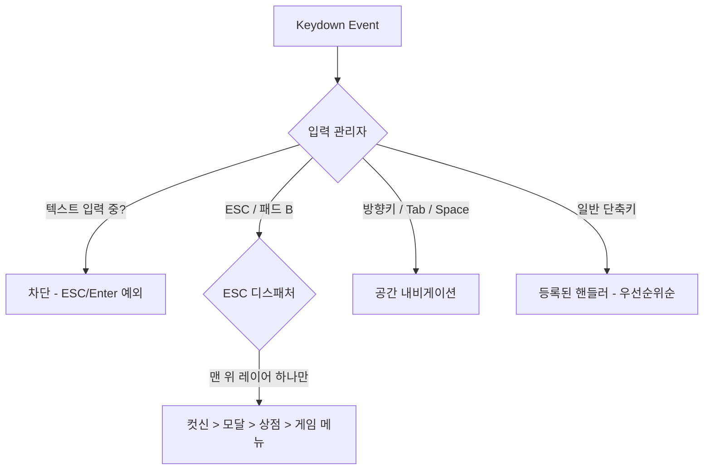

# ⌨️ Blosharper 키보드 단축키 치트시트

게임 플레이 중 사용 가능한 모든 단축키를 한눈에 확인하세요!

> **[← 게임 가이드로 돌아가기](./GAME_GUIDE.md)**

---

## 🎮 게임 플레이 단축키

### **카드 선택 및 조작**

|             키             | 기능           | 설명                                                             |
| :------------------------: | :------------- | :--------------------------------------------------------------- |
|          **1-8**           | 카드 선택/해제 | 화면에 보이는 순서대로 카드 토글 (1번째 카드부터 8번째 카드까지) |
|         **Enter**          | 족보 제출      | 선택한 카드로 족보를 제출 (치기 버튼과 동일, 모달이 없을 때)     |
| **Delete** / **Backspace** | 묻기           | 선택한 카드를 버리고 새 카드 받기 (묻기 버튼과 동일)             |
|           **F7**           | 스톱           | 현재까지 딴 돈을 확정하고 라운드 종료 (스톱 버튼 표시 중일 때)   |
|    **U** / **Ctrl+Z**      | 무르기         | 직전 액션(치기)을 되돌림 (무르기 가능 상태에서만)                |

### **정보 확인**

|  키   | 기능               | 설명                                                                              |
| :---: | :----------------- | :--------------------------------------------------------------------------------- |
| **H** | 족보 이력          | 현재 라운드에서 사용한 패와 버린 패의 기록 확인 (모달)                            |
| **R** | 족보표             | 족보 종류와 배수를 한눈에 확인                                                    |
| **I** | 카드 스킬 인벤토리 | 보유 중인 스킬 목록과 레벨 확인                                                   |
| **D** | 남은 패 목록       | 더미(덱)에 남아있는 카드를 월별로 확인                                            |
| **M** | 뒷골목 (상점)      | 뒷골목으로 이동하여 아이템 구매, 기술 전수 등. ⚠️ 보스전 중에는 이동 불가 (경고음) |
| **T** | 스탯 관리          | 캐릭터 스탯(구라/배짱/눈치/요행) 투자 및 관리 화면                                |

### **게임 메뉴 및 시스템**

|    키    | 기능                | 설명                                                                      |
| :------: | :------------------ | :------------------------------------------------------------------------ |
| **ESC**  | 닫기 / 게임 메뉴    | 열려 있는 UI를 위에서부터 하나씩 닫고, 아무것도 없으면 게임 메뉴 열기     |
| **F10**  | 게임 메뉴           | 모달이 열려 있으면 최상단 모달 닫기, 아니면 게임 메뉴 열기 (패드 Options) |
| **F8**   | 힌트                | 지금 낼 수 있는 조합 카드를 흔들어서 알려줌                               |
| **Alt**  | 카드 월 표시 (홀드) | 누르고 있는 동안 모든 카드에 월 정보 + 게임패드 버튼 배지 표시            |
| **F9**   | 카드 월 표시 (토글) | 누를 때마다 카드 월 정보 + 게임패드 배지 표시 토글                        |

---

## 🧭 키보드 내비게이션

|              키              | 기능             | 설명                                                  |
| :--------------------------: | :--------------- | :----------------------------------------------------- |
|         **↑/↓/←/→**          | 공간 이동        | 현재 포커스에서 해당 방향으로 가장 가까운 요소로 이동 |
|     **방향키 2개 동시**      | 사선 이동        | 예: ↑+→를 함께 누르면 우상단 방향으로 이동            |
|       **Tab / S-Tab**        | 순차 이동        | 현재 열린 화면(스코프) 안에서만 순환 (포커스 트랩)    |
|          **Space**           | 포커스 요소 실행 | 현재 포커스된 버튼 클릭 또는 카드 선택                |
| **PgUp/PgDn, Home/End**      | 스크롤           | 긴 목록/패널 스크롤 (Shift+↑/↓도 동일)                |

- **공간 탐색 방식**: 방향키 이동은 고정 순서가 아니라 화면 좌표 기준입니다 — 누른 방향에서 각도·거리상 가장 가까운 요소로 포커스가 이동합니다.
- **손패 좌우 순환**: 카드 영역 안에서만 순환합니다. 첫 카드에서 ←는 마지막 카드로, 마지막 카드에서 →는 덱으로, 덱에서 다시 →는 첫 카드로 이어집니다.
- **Space와 Enter는 다릅니다**: Space는 "포커스된 요소를 클릭"하고, Enter는 게임 중(모달 없음)에는 포커스와 무관하게 "족보 제출", 모달 안에서는 "확인"으로 동작합니다.
- **ESC 1타 = 포커스 해제**: 금색 테두리 포커스가 잡혀 있으면 ESC 첫 입력은 포커스를 해제하고, 한 번 더 누르면 게임 메뉴가 열립니다.
- **카드 포커스** 시 해당 카드의 툴팁이 자동 표시되고, 호버 효과가 적용됩니다.
- **숨겨진 UI 차단**: 닫혀 있는 패널이나 `display: none` 상태의 조건부 버튼(스톱, 탄, 낱장치기, 무르기)에는 포커스가 가지 않습니다.
- **카드 정렬 동기화**: 카드가 추가/제거될 때 DOM 순서가 시각적 정렬과 동기화되어 포커스 순서가 화면에 보이는 순서와 일치합니다.
- **마우스 전환**: 마우스 클릭 시 키보드 포커스 비주얼이 자동 해제되어 불필요한 포커스 링이 표시되지 않습니다.

포커스가 순회하는 주요 영역:

```
[ 탑바 ]        라운드(메뉴) → 딴돈/판돈 → 치기/묻기 → 배점×배수 → 스탯 → 스킬 보따리
[ 카드 영역 ]    카드 1 → 카드 2 → ... → 카드 N → 덱
[ 보톰바 ]      묻기 → 치기 → 스톱 → 탄(🎴) → 낱장치기(🤏) → 무르기
[ 플레이어 덱 ]  스탯 → 뒷골목  (화면 좌하단)
```

---

## 🪟 모달/패널 제어

### **열기**

|  키   | 기능              | 조건                                |
| :---: | :---------------- | :---------------------------------- |
| **H** | 족보 이력 열기    | 모달이 없을 때 (카드 선택 모달)     |
| **R** | 족보표 열기       | 모달이 없을 때                      |
| **I** | 인벤토리 열기     | 모달이 없고, 인벤토리가 닫혀있을 때 |
| **D** | 남은 패 모달 열기 | 모달이 없을 때                      |
| **M** | 뒷골목 열기       | 모달이 없고, 보스전이 아닐 때       |
| **T** | 스탯 관리 열기    | 모달이 없을 때                      |

### **닫기 (ESC 키 우선순위)**

ESC 한 번은 정확히 **하나의 표면**만 닫습니다. 판정은 2단계입니다:

```
1️⃣ 전체 화면 표면 우선
   컷신, 스태프롤, 설정/갤러리 화면처럼 화면 전체를 덮는 표면이
   떠 있으면 ESC는 무조건 그쪽에서 처리됩니다.
   ↓
2️⃣ 게임판 위 적층 순서
   모달 · 스킬 인벤토리 (여러 개면 나중에 연 것부터)
   → 뒷골목 (상점)
   → 게임 메뉴 (아무것도 없을 때 열기)
```

즉 뒷골목에서 모달을 연 상태라면 ESC는 **모달을 먼저** 닫고, 한 번 더 눌러야 뒷골목이 닫힙니다.

### **모달 공통 단축키**

|    키     | 기능      | 예시                                                                    |
| :-------: | :-------- | :----------------------------------------------------------------------- |
| **Enter** | 확인/실행 | 레벨업 완료, 재도전, 카드 선택 확인 등                                  |
|  **ESC**  | 취소/닫기 | 모달 닫기, 스킬 선택 스킵 등                                            |
| **[ / ]** | 탭 전환   | 카드 선택(이력/남은 패)·족보표·설정·갤러리 화면의 탭 이동 (패드 LB/RB)  |

### **모달별 Enter 키 동작**

| 모달               | Enter 동작               |
| :----------------- | :----------------------- |
| **게임 메뉴**      | ❌ 비활성 (클릭 필요)    |
| **스탯 상세**      | 모달 닫기                |
| **레벨업**         | 강화 완료                |
| **게임오버**       | 재도전                   |
| **알림**           | 확인                     |
| **카드 선택**      | 선택 확인 (카드 선택 시) |
| **남은 패 목록**   | 모달 닫기                |
| **족보 이력**      | 모달 닫기                |
| **카드 스킬 선택** | ❌ 비활성 (클릭 필요)    |
| **족보 안내**      | 확인 (닫기)              |
| **통장 내역**      | 확인 (닫기)              |
| **은행 입출금**    | 금액 확정                |
| **화투통 개조**    | 선택 확정                |
| **보스 보상 봉투** | 포커스된 봉투 선택       |

### **모달별 ESC 키 동작**

| 모달               | ESC 동작                       |
| :----------------- | :----------------------------- |
| **게임 메뉴**      | 모달 닫기                      |
| **스탯 상세**      | 모달 닫기                      |
| **레벨업**         | 모달 닫기 (포인트 남아도)      |
| **게임오버**       | ❌ 비활성 (재도전 강제)        |
| **알림**           | 모달 닫기                      |
| **카드 선택**      | 선택 취소 및 모달 닫기         |
| **남은 패 목록**   | 모달 닫기                      |
| **족보 이력**      | 모달 닫기                      |
| **카드 스킬 선택** | 스킵 (선택 안 함)              |
| **족보 안내**      | 모달 닫기                      |
| **통장 내역**      | 모달 닫기                      |
| **은행 입출금**    | 취소                           |
| **화투통 개조**    | 취소 (선택 안 함)              |
| **보스 보상 봉투** | ❌ 비활성 (건너뛰기 버튼 사용) |
| **보스 도전**      | 기권 (기권 불가 도전은 무시)   |

### **보상 선택 모달 전용 키**

라운드 클리어 후 기술 선택 모달에서는 아래 키가 추가로 동작합니다:

|      키      | 기능                          |
| :----------: | :---------------------------- |
| **D / F7**   | 리롤 (물리기) — 패드 Y와 동일 |
|    **I**     | 인벤토리 열기/닫기            |

---

## 🎮 게임패드

키보드 없이 게임패드만으로도 전체 UI를 조작할 수 있습니다.

- **지원 방식**: Steam Input(스팀 덱 포함), 브라우저 표준 게임패드, DualSense 전용 연결(진동 피드백 지원)을 모두 지원합니다.
- **동작 원리**: 게임패드 버튼은 대응하는 키보드 키로 변환되어 동작합니다 — A=Space(선택), B=ESC(취소/닫기), Y=F7(스톱/리롤), LB/RB=[ / ](탭 전환), Options=F10(게임 메뉴), 스틱/십자키=방향 이동 등.
- **버튼 배지**: **Alt**(홀드) 또는 **F9**(토글)를 누르면 화면 버튼 위에 게임패드 버튼 배지가 표시되어 어떤 버튼이 어디에 대응하는지 확인할 수 있습니다.
- **진동**: DualSense 연결 시 게임 상황(경고, 타격 등)에 맞는 햅틱 피드백이 재생됩니다.

---

## 🚫 단축키 제한 사항

### **작동하지 않는 경우**

- ❌ **INPUT/TEXTAREA**에 포커스가 있을 때 일반 단축키가 차단됩니다. 단 **ESC**(입력 취소/포커스 해제)와 **Enter**(입력 확정)는 예외로 동작합니다.
- ❌ 입력창에서 **Shift+Enter / Ctrl+Enter**는 단축키를 우회하여 개행으로 처리됩니다.
- ❌ **모달**이 열려있을 때는 게임 플레이 단축키 대부분(Enter 제출, 묻기, 스톱 등)이 차단됩니다.

---

## 📝 단축키 구현 상세

키 입력은 하나의 관리자가 아니라 역할이 다른 세 축이 나눠 처리합니다:

1. **입력 관리자**: 모든 `keydown`을 받아 우선순위가 매겨진 등록 목록으로 분배합니다. 텍스트 입력 중 차단/예외 처리도 여기서 담당합니다.
2. **ESC 디스패처**: ESC(및 패드 B)만 별도로 라우팅합니다. 화면 표면(모달, 상점, 컷신 등)이 열릴 때마다 레이어로 등록되고, ESC가 오면 "지금 맨 위에 보이는 레이어" 하나에게만 취소를 전달합니다. 위의 [ESC 키 우선순위](#닫기-esc-키-우선순위)가 이 사다리입니다.
3. **공간 내비게이션**: 방향키/Tab/Space에 의한 포커스 이동·실행·스크롤을 담당합니다. 화면 좌표 기준으로 가장 가까운 요소를 찾습니다.



---

## 🖥️ Electron 네이티브 메뉴 (데스크톱 앱)

데스크톱 앱에서는 네이티브 메뉴바를 통해 모든 게임 동작에 접근할 수 있습니다. 아래 메뉴 단축키 중 일부는 **데스크톱 앱 전용**입니다.

### **동작 메뉴**

| 메뉴 항목 | 단축키    | 기능                                              |
| :-------- | :-------- | :------------------------------------------------ |
| 치기      | Enter     | 족보 제출                                         |
| 묻기      | Backspace | 카드 버리기                                       |
| 그만하기  | S         | 스톱 (라운드 종료) — ⚠️ 데스크톱 앱 전용, 웹은 F7 |
| 되돌리기  | Ctrl+Z    | 직전 액션 되돌리기                                |
| 게임 메뉴 | Escape    | 게임 메뉴 모달 열기                               |

### **보기 메뉴**

| 메뉴 항목               | 단축키 | 기능                |
| :---------------------- | :----- | :------------------ |
| 스킬 인벤토리           | I      | 보유 스킬 목록      |
| 족보 이력               | H      | 족보 이력 모달      |
| 족보표                  | R      | 족보 종류/배수 확인 |
| 남은 패                 | D      | 남은 카드 확인      |
| 도시 이동 (뒷골목)      | M      | 뒷골목 상점 열기    |
| 스탯 관리               | T      | 스탯 투자/관리 화면 |
| 확대 / 축소 / 원래 크기 | —      | 화면 배율 조정      |
| 전체화면                | —      | 전체화면 토글       |

### **설정 메뉴**

| 메뉴 항목   | 단축키       | 타입                                  |
| :---------- | :----------- | :------------------------------------ |
| 음소거      | Ctrl+Shift+M | 체크박스 — ⚠️ 데스크톱 앱 전용 단축키 |
| 게임 힌트   | —            | 체크박스                              |
| 레트로 효과 | —            | 체크박스                              |

> **메뉴 상태 동기화**: 게임 상태에 따라 메뉴 아이템이 자동으로 활성/비활성됩니다. 예를 들어 게임 중이 아니면 "치기", "묻기" 등은 비활성 상태입니다.

---

## 💡 사용 팁

1. **빠른 카드 플레이**: `1-8` 키로 카드 선택 → `Enter`로 제출, `Delete`로 묻기, `F7`로 스톱
2. **빠른 정보 확인**: `H` → 족보 이력, `R` → 족보표, `I` → 스킬 목록, `D` → 남은 패, `M` → 뒷골목, `T` → 스탯 관리
3. **ESC 연타**: 열린 것들을 위에서부터 하나씩 빠르게 닫기 (모달 → 상점 → 게임 메뉴 순)
4. **Enter 활용**: 모달에서 마우스 없이 빠른 확인, 게임 중에는 족보 제출
5. **Alt / F9 / 설정 활용**: 복잡한 조합을 찾을 때 Alt 키(홀드) 또는 F9 키(토글)로 카드 월 표시 정보(좌상단 텍스트)를 노출시키거나, 환경 설정에서 '카드 번호 표시'를 켜면 모든 카드 우측 상단에 카드 번호(월 숫자 배지)가 항상 표시되어 빠른 판단에 유용합니다.
6. **키보드만으로 플레이**: 방향키(사선은 두 키 동시)로 이동, Space로 실행, `[ / ]`로 탭 전환 — 마우스 없이 전체 UI 조작이 가능합니다.
7. **Electron 메뉴**: 데스크톱 앱에서는 상단 메뉴바로 모든 기능에 접근 가능합니다.

---

> **[← 게임 가이드로 돌아가기](./GAME_GUIDE.md)**
